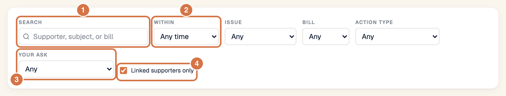

Open **Advocacy → Actions** to review synced activity, newest first.

## Narrow the activity

1. Search using **Supporter, subject, or bill**.
2. Set **Within** to the time window you need.
3. Choose **Issue**, **Bill**, or **Action type** to narrow further.
4. Use **Your ask** to filter by the position your organization took:
   - **Asked to support** or **Asked to oppose** — your campaign asked for that position.
   - **Support if amended** — your organization supports the bill only if it's amended.
   - **Monitoring (no position)** — your organization tracks the bill without taking a position, so there was no ask.
   - **Neutral** or **Unknown** — no support or oppose position was recorded.
5. Review the matching rows and open available contact links to investigate an individual.

<Frame caption="The Actions filters: (1) search, (2) Within, (3) Your ask, (4) Linked supporters only.">
  
</Frame>

The campaign's requested position is context for the action; do not interpret it as a complete profile of the supporter's beliefs.

The **Recipients** column counts who the message went to. A **failed** count beneath it means the letter could not be delivered to that many recipients.

## Check missing activity

The list starts with **Linked supporters only** ticked. Untick it to include activity from supporters who aren't linked to a contact. Choose **Clear filters** to remove other restrictions. Confirm the activity occurred in the connected source and inspect sync health on the advocacy dashboard. A row without a linked contact may still be valid synced activity; use [Match Review](/advocacy/match-review) to connect it.

This screen reports incoming activity. It does not send a new advocacy action to a legislator.
