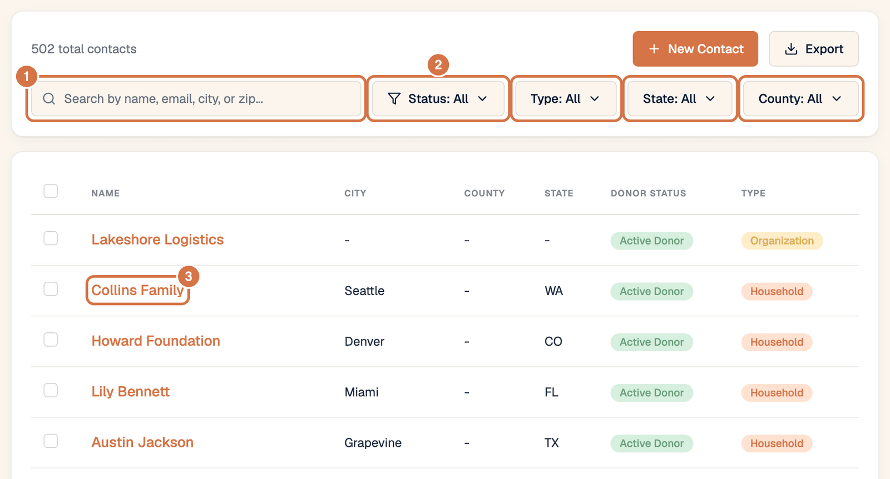
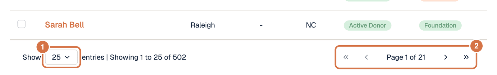

The **Contacts** page lists every household, organization, and foundation in your account. Use search and filters to narrow the list, then click any name to open that contact's profile.

<Frame caption="The Contacts page: (1) the search box, (2) the filter dropdowns, (3) a contact's name opens the profile.">
  
</Frame>

## Search

Start typing in the search box at the top of the list. Advocora matches on:

- Contact **name** (household, organization, or any person in it)
- **Email** address
- **Phone** number (at least seven digits, in any format)
- **Street**, **city**, or **ZIP / postal code**

Results update as you type, so you usually only need a few characters.

## Filters

Narrow the list using the filter dropdowns. Each one shows its current choice, such as **Status: All**.

| Filter | What it does |
| --- | --- |
| **Status** | Show only **Active Donor**, **Inactive Donor**, or **Nondonor** contacts. [Learn how status is calculated.](/contacts/donor-status) |
| **Type** | Show only Households, Organizations, or Foundations. |
| **State** | Show contacts in a specific U.S. state. |
| **County** | Show contacts in a specific county. |

<Tip>
  Filters stack. For example, combine **Status: Active Donor** \+ **State: Texas** to see only your active donors in Texas.
</Tip>

## What the columns show

The list displays each contact's **Name**, **City**, **County**, **State**, **Donor Status**, and **Type**. Donor status and type appear as color-coded badges so you can scan the list quickly.

## Paging through results

At the bottom of the list you can:

- Choose how many contacts to show per page in the **Show … entries** control (**10, 25, 50, or 100**).
- Move between pages with the page controls.

<Frame caption="The bottom of the list: (1) contacts per page, (2) the page controls.">
  
</Frame>

When you change a filter, the list jumps back to the first page so you never see stale results.

## Common tasks

<AccordionGroup>
  <Accordion title="See only my active donors">
    Set the **Status** filter to **Active Donor**.
  </Accordion>

  <Accordion title="Find one specific person">
    Type their name or email into the search box.
  </Accordion>

  <Accordion title="See everyone in one county">
    Use the **County** filter (optionally combined with **State**).
  </Accordion>
</AccordionGroup>

## When a record is missing

Clear all filters and search by email or part of the household name. A person can be an individual inside a household rather than a separate contact. Incoming form subscribers may still be waiting in [Subscriber Match](/data-management/subscriber-match). Confirm you are in the intended organization before creating a replacement record.
