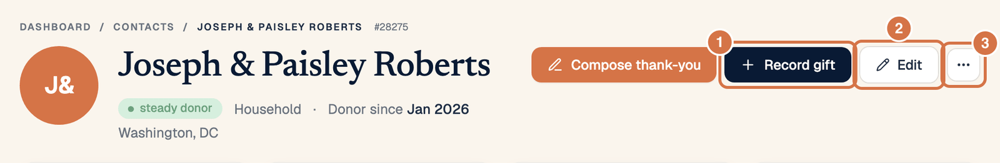
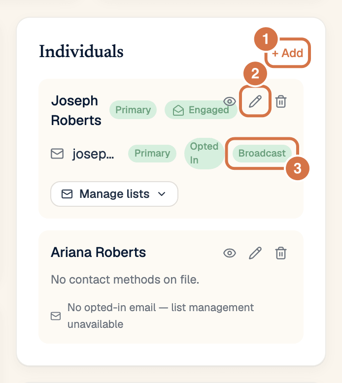
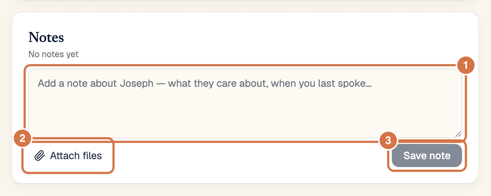

Open any contact to manage everything about your relationship with them. This page covers the most common updates you'll make from a contact's profile.

<Frame caption="The top of a profile: (1) Record gift, (2) edit the contact, (3) more actions, where a contact is deleted.">
  
</Frame>

## Edit contact details

Click **Edit Contact** to update the contact's name, address, and any custom fields. When you change the address, choose one of the suggestions. Advocora looks up the county and legislative districts when you save.

## Manage people (households)

For households, the **People** section lists everyone in the contact.

- **Add a person** — click **Add Individual** and enter their name and contact methods.
- **Edit a person** — open a person to update their name, emails, and phones, including which are **Primary** and **Opted in**.
- **Remove a person** — deleting a person is permanent and asks you to confirm first.

<Frame caption="The people in a household: (1) add a person, (2) edit a person, (3) the Broadcast label on the email campaigns go to.">
  
</Frame>

### Contact methods

Each person can have multiple emails and phone numbers. For each, you can mark one **Primary** of its kind and toggle **Opted in** to track communication consent. Opt-in status matters for email—contacts who aren't opted in won't receive campaigns.

When someone has an opted-in email, one address carries a **Broadcast** label. That's the address your campaigns go to. Advocora chooses it automatically: the primary email if it's opted in, otherwise the first opted-in email on file. If the person opts out of that address, **Broadcast** moves to another opted-in address, or disappears when none is left. You don't set it by hand, and it doesn't change where gift receipts and other automatic emails are sent.

## Address, county, and districts

The **Contact info** section shows the mailing address and, when available, the county and congressional/state house/state senate districts. If the address has been geocoded, you can open a map to see the district boundaries.

<Note>
District information can be turned off for an organization that doesn't work with districts. When it's off, **Contact info** shows the address and county only, and the address doesn't open the district map. Use **Get support** to ask for it to be turned on or off.
</Note>

District lines change after a redistricting. Advocora can refresh the stored districts for a whole state, so a contact's districts, and the queries, segments, and reports that use them, can change without anyone editing the contact. On the map, the congressional boundary names the Congress it belongs to, such as **120th Congress**. For a time the map can show a newer boundary than the district saved on the contact.

## Custom fields

If your organization has active [custom fields](/data-management/lookup-tables), their values appear in the **Custom fields** card on the profile. Click **Edit** on the card, or **Edit Contact**, to change them. They belong to the contact as a whole, not to each person in a household.

## Tags

Tags help you group and segment contacts. In the **Tags** section, click **Edit** to add or remove tags. (Donor status is calculated automatically and isn't something you set by hand—see [Donor status](/contacts/donor-status).)

## Notes

Use **Notes** to capture context—call summaries, preferences, relationship history. Type your note in the **Notes** section and click **Save note**. Notes appear newest-first. You can edit or delete a note you created.

<Frame caption="The Notes section: (1) type the note, (2) Attach files, (3) Save note.">
  
</Frame>

### Attach files to a note

To keep a scanned letter, a pledge card, or a photo with a note, click **Attach files** before you save it and choose one or more files. A note needs some text before you can save it with files. Each file is listed under the note. Click a file to view it without leaving the page, or click the download arrow next to it to save a copy.

- You can attach images (JPG, PNG, GIF, WebP, HEIC), PDFs, Word, Excel and PowerPoint files, CSV, and text files.
- Images, PDFs, and plain text and CSV files open in the viewer. Word, Excel, PowerPoint, RTF, and HEIC files, and text files over 512 KB, can't be shown there; download them to open them.
- Each file can be up to 8 MB, and a note can have up to 10 files.
- To add or remove files later, click the pencil icon on a note you created. Deleting a note deletes its files too.

Anyone on your team who can view the contact can open a note's files. Files are private to your organization and can't be opened by a link from outside Advocora.

## Event attendance

When someone in the contact came to an event as a guest on another person's registration, and the guest has been matched to them, the activity timeline shows that they attended as a guest. See [Event match](/data-management/event-match).

## Record a gift

Click **Record gift** to log a donation—amount, date, and details. New gifts appear in the activity timeline and update the contact's giving summary and [donor status](/contacts/donor-status) automatically.

## Log a touch

Click **Log touch** to record an interaction such as a call, email, or meeting. Touches appear in the activity timeline so your whole team can see the latest engagement.

## Delete a contact

If you need to remove a contact, use **Delete contact** and confirm when prompted.

<Warning>
  A contact that has recorded gifts can't be deleted—this protects your giving history. Deletion is permanent and can't be undone.
</Warning>

## Review the result

After editing, reopen the relevant section and confirm the saved values. Check that an email belongs to the intended individual, especially in households with several people. Membership and advocacy sections appear when applicable; use their linked details for those workflows.

If an edit or deletion is denied, check your role and whether the record is protected by related history. Use [Contact Merge](/data-management/contact-merge) for duplicate contacts rather than deleting one that contains history you need to retain.
