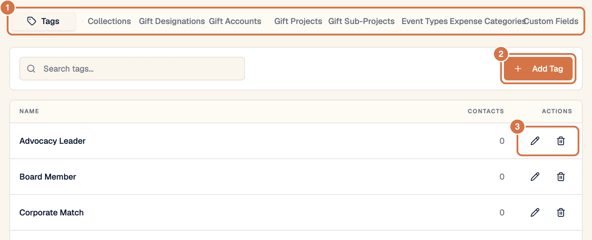
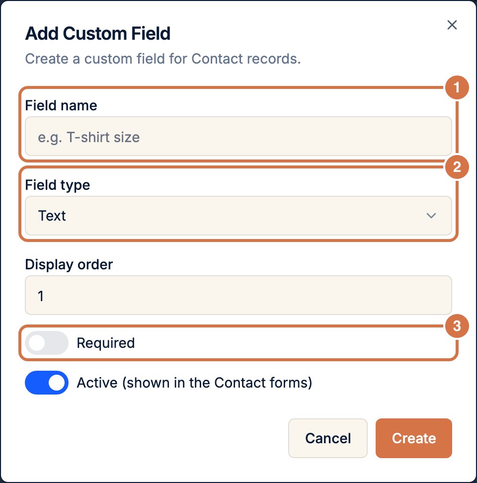

Open **Data Management → Lookup Tables** to manage the shared choices used throughout Advocora.

| Tab | Purpose |
| --- | --- |
| Tags | Labels used to organize contacts |
| Collections | Groups used to organize individuals |
| Gift Designations | The purpose assigned to a gift |
| Gift Accounts | The account category assigned to a gift |
| Gift Projects | Projects used to categorize giving |
| Gift Sub-Projects | More specific categories within projects |
| Event Types | Event classification, when Events is enabled |
| Expense Categories | Categories for event expenses, when Events is enabled |
| Custom Fields | Extra fields on contact records |

<Frame caption="Lookup Tables: (1) the tabs, one for each list, (2) the tab's add action, (3) edit or delete an entry.">
  
</Frame>

A gift account is a CRM category. A Stripe Connect account is the payment-processing connection; they serve different purposes.

## Add or update an entry

1. Choose the relevant tab.
2. Check whether an equivalent entry already exists, including spelling variants.
3. Use the tab's add action, enter the required name and settings, and save.
4. Open a record or form that uses the list and confirm the option appears.
5. To rename or retire an entry, review its usage and the available edit/deactivation controls first.

For a sub-project, select its parent project. A donation form can route gifts to a project and either a fixed sub-project or a supporter-selected sub-project.

## Add a custom field

On the **Custom Fields** tab, choose **Add Custom Field**, then enter the **Field name** and **Field type** (text, number, date, dropdown, or checkbox). A dropdown needs at least one option. You can make a field required, set its display order, or make it inactive to hide it.

<Frame caption="Add Custom Field: (1) Field name, (2) Field type, (3) make the field required.">
  
</Frame>

Active fields appear when you add or edit a contact and on the contact's profile. The field type can't be changed later, and a field that has values on any contact can't be deleted. Make it inactive instead, or clear the values first.

## Troubleshooting

An entry in use may be protected from deletion. Use the supported deactivation option where available so you preserve existing classifications. If an option is missing, check whether it is active and whether the parent project or module is selected.

Coordinate naming with your team before changing shared categories: they affect everyone's filters and [reports](/reports/overview).
