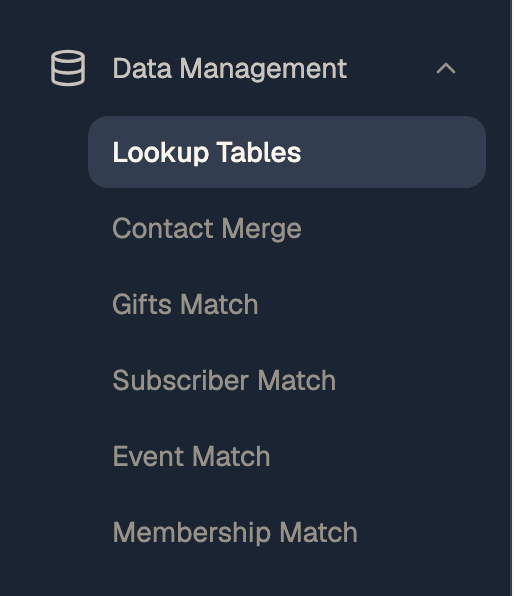

**Data Management** keeps your database tidy and trustworthy. It's where you maintain shared lists, merge duplicate contacts, and connect incoming records—online subscribers, Stripe subscriptions, event buyers, membership sign-ups—to the right people.

## The tools

<CardGroup cols={2}>
  <Card title="Lookup tables" icon="table-list" href="/data-management/lookup-tables">
    Maintain the shared lists used across Advocora—tags, collections, designations, accounts, and more.
  </Card>

  <Card title="Contact merge" icon="object-group" href="/data-management/contact-merge">
    Find and combine duplicate contact records.
  </Card>

  <Card title="Subscriber match" icon="user-check" href="/data-management/subscriber-match">
    Link form and newsletter signups to contacts.
  </Card>

  <Card title="Gifts match" icon="link" href="/data-management/gifts-match">
    Connect imported Stripe subscriptions to contacts.
  </Card>

  <Card title="Event match" icon="calendar-check" href="/data-management/event-match">
    Reconcile public event buyers who weren't recognized, review new addresses, and identify guests.
  </Card>

  <Card title="Membership match" icon="id-card" href="/data-management/membership-match">
    Check membership sign-ups that were attached to a contact by a best guess. Appears when Memberships is enabled.
  </Card>

  <Card title="API match" icon="plug-circle-check" href="/data-management/api-match">
    Decide whether a contact sent by a connected system is already in your records. Appears when the API is included in your plan.
  </Card>
</CardGroup>

<Frame caption="Data Management in the sidebar, with its tools listed beneath it.">
  
</Frame>

## Why it matters

When money comes in or someone signs up online, Advocora tries to recognize the person automatically. When it can't be sure, rather than guess, it sets the record aside in one of the **match** tools for you to confirm—so you can decide which record is right. Online membership sign-ups work a little differently: they're attached to a contact straight away, and uncertain ones are listed for you to check.

<Warning>
  Several actions here—especially **merging contacts**—can't be undone. Each tool flags the irreversible steps clearly; read the confirmation before you commit.
</Warning>
