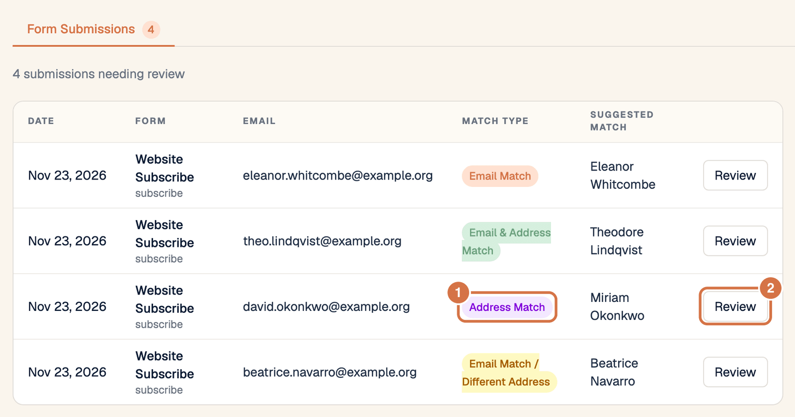
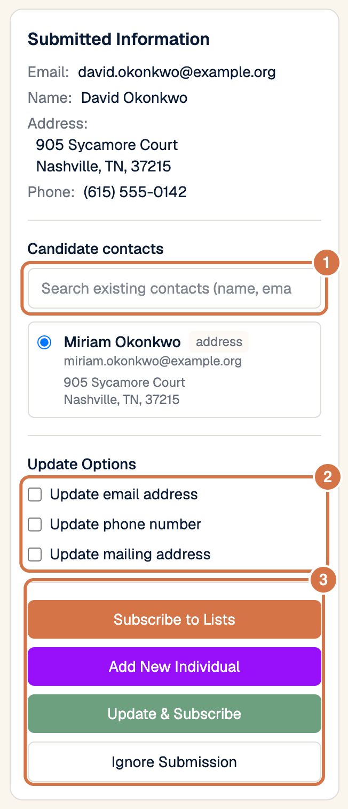

When someone subscribes through a form—or syncs in from Mailchimp or Constant Contact—Advocora tries to recognize them. When it can't be certain, the record waits here in **Subscriber match** for you to confirm.

## Where records come from

The page has up to three tabs, depending on your integrations:

- **Form Submissions** — signups from your [subscribe](/forms/subscribe-forms) and other forms
- **Mailchimp Unmatched** — shown when Mailchimp is connected
- **CC Unmatched** — shown when Constant Contact is connected

Form submissions show a **Match Type** badge—_Email Match_, _Address Match_, _Email & Address Match_, or _Email Match / Different Address_—to hint at how confident the suggestion is.

<Frame caption="The Form Submissions tab: (1) the Match Type badge, (2) Review opens the record.">
  
</Frame>

## Reviewing a record

<Steps>
  <Step title="Open it">
    Choose **Review** to see the submitted details and any suggested contact.
  </Step>
  <Step title="Find the right contact">
    Accept the suggestion or search by name, email, or address.
  </Step>
  <Step title="Choose what to do">
    - **Subscribe to Lists** — add them to your email lists.
    - **Update & Subscribe** — also update their email, phone, or mailing address.
    - **Add New Individual** — add them as a person within the contact.
    - **Ignore Submission** — set the record aside.

    **Create New Contact** is offered on the Mailchimp and Constant Contact tabs, not on **Form Submissions**.
  </Step>
</Steps>

<Frame caption="A submission's panel: (1) search for a contact, (2) choose what to update, (3) the actions.">
  
</Frame>

<Note>
  If a household has several people, you'll be asked **which individual** to update or attach the email to—so the right person gets the contact details.
</Note>

<Tip>
  Clear this queue regularly. It's how new supporters become real contacts you can cultivate, rather than stranded signups.
</Tip>

## When the person had opted out

Submitting a form counts as fresh consent. When you subscribe a matched person, the submitted email is opted in again and any earlier unsubscribe or bounce on it is cleared, so campaigns can reach them.

Advocora keeps the opt-out, and shows you a message, in two cases:

- The person previously marked one of your emails as spam. They're added to the lists but won't receive campaigns.
- They unsubscribed, or their email bounced, after they submitted the form.

If the submission has no email address, nothing about email consent changes. You need permission to create contacts to process this queue.

## Verify a completed match

Search the contact's individual and the intended email list after the action. Confirm both the contact data and communication preferences before treating the signup as ready for a campaign. When multiple household members share an address, compare the submitted name rather than automatically selecting the primary person.

If review fails, refresh the queue and search the contact before retrying. If no matching record appears, check which source tab and filters are selected.
