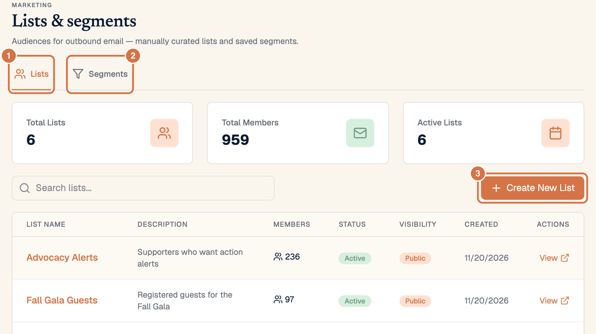
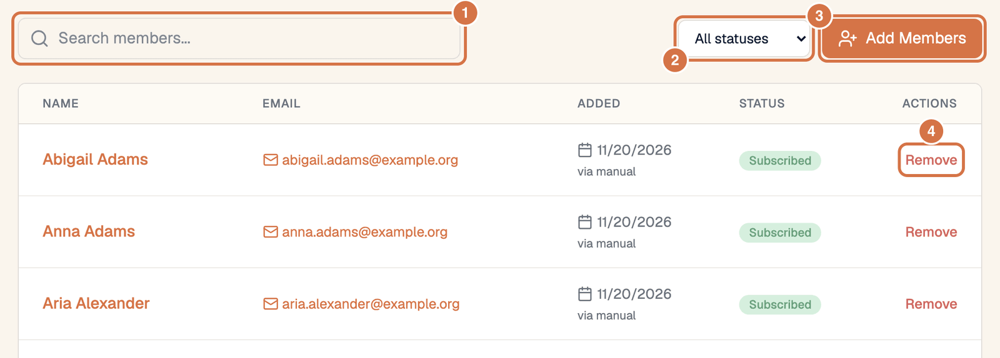
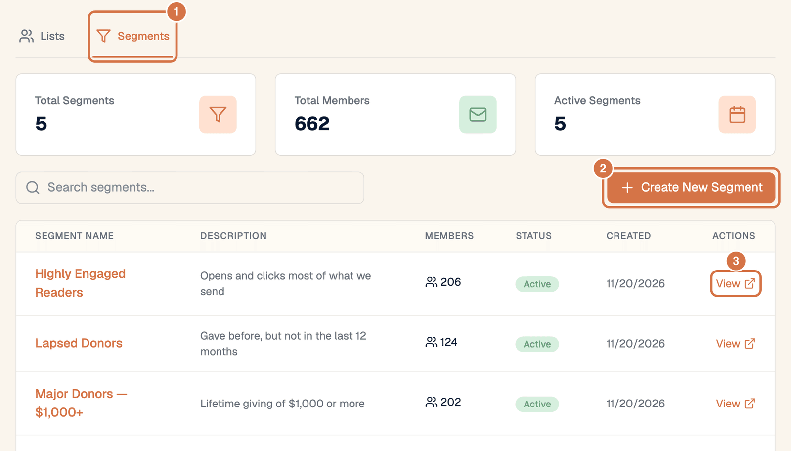
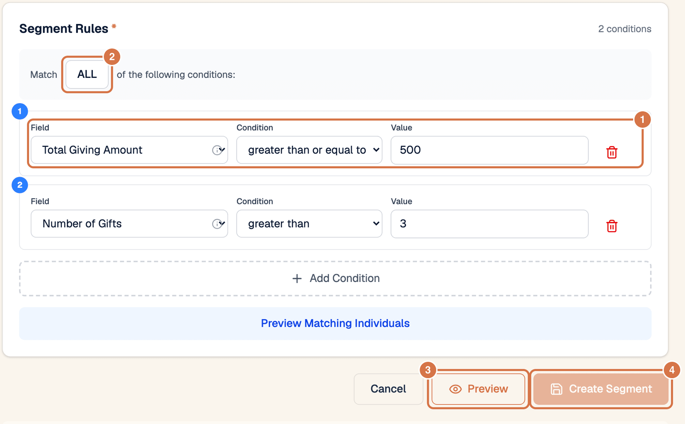

Every campaign goes to an audience. Advocora gives you two kinds, on two tabs of the **Lists & segments** page.

<Frame caption="The Lists & segments page: (1) the Lists tab, (2) the Segments tab, (3) Create New List.">
  
</Frame>

<CardGroup cols={2}>
  <Card title="Lists" icon="list">
    **Static.** You add and remove members yourself. Good for fixed groups—board members, a committee, event VIPs.
  </Card>

  <Card title="Segments" icon="filter">
    **Dynamic.** Defined by rules. Membership recalculates automatically as contacts change.
  </Card>
</CardGroup>

## Working with lists

Choose **Create New List**, give it a name, and save. Open a list to see two tabs:

- **Members** — search, filter by subscribed/unsubscribed, **Add Members**, or remove them.
- **Settings** — rename, edit the description, toggle active/inactive, set public or internal, or delete.

<Frame caption="A list's Members tab: (1) search, (2) filter by subscribed or unsubscribed, (3) Add Members, (4) remove a member.">
  
</Frame>

## Working with segments

<Frame caption="The Segments tab: (1) the tab, (2) Create New Segment, (3) View opens a segment.">
  
</Frame>

Choose **Create New Segment**, name it, then build the rules:

<Steps>
  <Step title="Add conditions">
    Each condition is a **field**, an **operator**, and a **value** (for example, "State is one of CA, OR, WA").
  </Step>
  <Step title="Match all or any">
    With two or more conditions, the builder shows **Match ALL of the following conditions**. Leave **ALL** to require every condition, or select it to switch to **ANY** and match any.
  </Step>
  <Step title="Preview">
    Choose **Preview**, or **Preview Matching Individuals** under the conditions, to see how many individuals match and a sample of who. Both buttons do the same thing.
  </Step>
  <Step title="Create Segment">
    Save it. Open the segment and use **Refresh** anytime to recalculate.
  </Step>
</Steps>

<Frame caption="Segment rules: (1) a condition's field, operator and value, (2) whether contacts must match all of the conditions or any of them, (3) Preview, (4) Create Segment.">
  
</Frame>

<Note>
  Unsubscribed contacts are automatically excluded from every send—you never have to manage that by hand.
</Note>

<Tip>
  Use a **list** for a known, unchanging group and a **segment** when you want the audience to keep itself current (like "gave in the last 90 days").
</Tip>

## Verify audience changes

After adding someone, search the list for the individual's email and review their subscribed state. For a segment, use **Preview** or **Refresh** and inspect the rules and sample results. Changes to a person's data can change whether they match a dynamic segment.

List membership, email opt-in, and suppression are separate checks. An unsubscribed or suppressed address may be excluded even when the person appears in a list. For bulk list updates, use [Individuals query results](/queries/bulk-actions).

## Troubleshooting

If a list or segment is missing, check the selected sending domain and active state. If a segment is too broad, inspect the **ALL** / **ANY** setting and date conditions. If a supporter remains absent, review [Subscriber Match](/data-management/subscriber-match) before adding a duplicate person.
