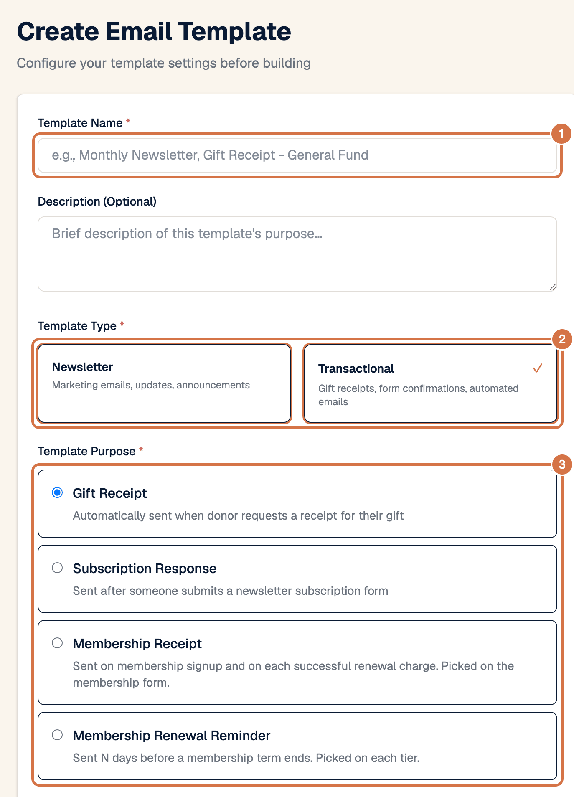
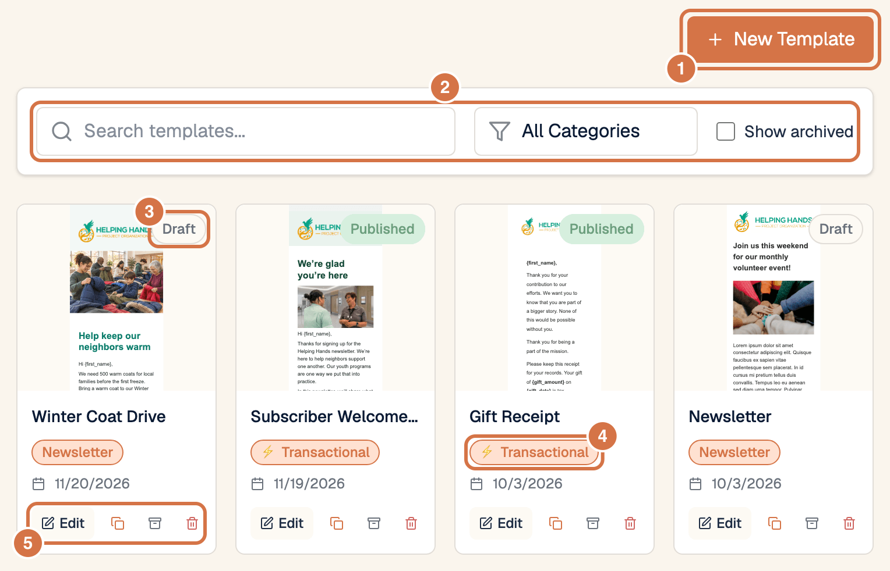
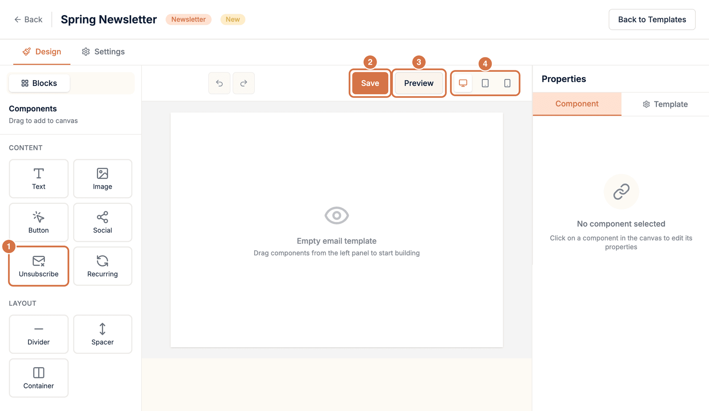

**Templates** are reusable email designs. Build one once with the drag-and-drop editor and use it across many campaigns—or wire it up to send automatically.

## Create a template

<Steps>
  <Step title="Choose New Template">
    Give it a **name** and optional description.
  </Step>
  <Step title="Pick a type">
    - **Newsletter** — marketing emails, updates, announcements.
    - **Transactional** — automatic emails like receipts and confirmations.
  </Step>
  <Step title="Pick a purpose (transactional only)">
    Choose what triggers it (see below).
  </Step>
  <Step title="Continue to Builder">
    Design the email, then save.
  </Step>
</Steps>

<Frame caption="Setting up a new template: (1) its name, (2) its type, (3) its purpose, which appears for a transactional template.">
  
</Frame>

## Transactional purposes

Transactional templates are used when a matching workflow is configured to use them:

<AccordionGroup>
  <Accordion title="Gift Receipt" icon="receipt">
    Sent when a donor's gift is receipted. Tied to a specific **gift account**—you can have a different receipt per account.
  </Accordion>

  <Accordion title="Subscription Response" icon="envelope-open-text">
    Sent after someone submits a newsletter [subscribe form](/forms/subscribe-forms).
  </Accordion>

  <Accordion title="Membership Receipt" icon="id-card">
    Sent on membership signup and on each successful renewal charge.
  </Accordion>

  <Accordion title="Membership Renewal Reminder" icon="bell">
    Sent a set number of days before a membership term ends.
  </Accordion>
</AccordionGroup>

## Managing templates

Templates appear as cards showing a preview, status badge, and category. From each card you can **Edit**, **Duplicate**, **Archive**, or **Delete**. Filter by category or tick **Show archived** to see hidden ones.

<Frame caption="The templates list: (1) New Template, (2) search, the category filter and Show archived, (3) a card's status badge, (4) its category, (5) Edit, Duplicate, Archive and Delete.">
  
</Frame>

<Note>
  Templates start as **Draft** and become **Published** once saved from the builder. Published templates are the ones you can pick in the campaign wizard. A template cannot be published without an **Unsubscribe** block, unless it is a transactional template such as a receipt or reminder. If you try, a message at the top of the builder tells you to add the block. The same applies if you remove the block from a template that is already published.
</Note>

<Tip>
  Duplicate a template to make seasonal variations without rebuilding from scratch.
</Tip>

## Design and test the message

1. Open **Marketing → Email Templates**, create or edit a template, and enter the builder.
2. Add the needed content blocks and edit their text, links, images, and styling.
3. Insert personalization through the merge-tag controls so you use supported fields. Campaign messages need an **Unsubscribe** block.
4. Review desktop and mobile previews, then save. Check the saved status before selecting the template in a campaign or form.
5. Assign transactional templates to the form, gift account, or membership workflow that should use them. Creating a template alone does not enable an automatic email.
6. Test through the intended workflow using a controlled recipient.

<Frame caption="The builder: (1) the Unsubscribe block in the Blocks list, (2) Save, (3) Preview, (4) desktop, tablet and mobile views.">
  
</Frame>

## Troubleshooting

If a template is missing from a selector, check its type, purpose, published status, and sending-domain context. If personalized text is blank, check whether the recipient has that field populated. If a receipt does not send, inspect the triggering form/account configuration before recreating the gift.
