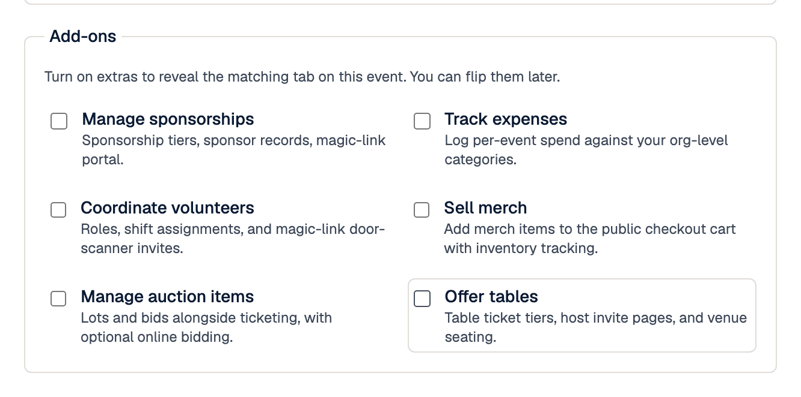

Each event can turn on extra tools as needed. Enable them when you [create the event](/events/create-an-event) (or later), and each appears as its own tab.

<Frame caption="Add-ons are chosen when you create an event, and can be changed later by editing it.">
  
</Frame>

## Tables

Turn on **Offer tables** to let a supporter take a whole table, become its host, and invite guests from a personal invite page. It adds the **Table** ticket type under **Ticketing** and a **Tables** tab, where you manage hosts and guests, seat the room, and download seating reports.

## Sponsors

Manage sponsorship **tiers** (name, price, available slots, perks, and an optional title tier) and the **sponsors** themselves—company, contact, tier, amount, contract status, and payment status.

**Logos.** When adding or editing a sponsor, upload a **logo** (PNG, JPEG, or SVG, up to 2 MB). Sponsors can also upload their own through the sponsor portal link. On the public event page a sponsor with a logo is shown as the logo; a sponsor without one is shown by name.

**Tier order.** Sponsors appear on the public page grouped under their tier, in the order the tiers are listed on the Sponsors tab. Drag tiers by the handle to reorder them, or choose **Sort by price** to put the highest tier first. Tiers with no sponsors are not shown on the public page.

Sponsors can sign their agreement and pay online from a private link. See [Manage sponsors](/events/sponsors).

## Expenses

Track what the event costs so you can see true net. Add **categories**, then log **expenses** with a vendor, optional memo, category, amount, status (pending or paid), and the date incurred. The summary shows total spend and net profit (gross minus expenses). On the event overview and the Events page, **Net** counts only expenses marked paid; pending and scheduled expenses are included in the **Projected** net.

<Note>
  Expense categories are shared across events and managed under [Settings](/settings/overview). Reusing them keeps your reporting consistent.
</Note>

## Auction

Run a silent or live auction alongside ticketing. Each **lot** has a number, name, description, donor, estimated value, starting bid, minimum increment, and bidding window. Lots move from **live** to **closed** to **paid** as bidding ends and you collect payment, and you can show an auction preview on the public page.

## Volunteers

Coordinate the people running your event.

<Steps>
  <Step title="Define roles">
    Add roles (Greeter, Registration, Floor Lead…) with how many you need, shift times, and whether the role **can check in** guests.
  </Step>
  <Step title="Build the roster">
    Add volunteers and assign them to roles. Track status as pending, confirmed, or no-show.
  </Step>
  <Step title="Send magic links">
    Send each volunteer a private link that opens the door scanner—no account required.
  </Step>
</Steps>

The tab also includes a **pre-event checklist**: whether every role is staffed, whether every volunteer has their link, and whether a test scan has been done.

<Tip>
  Do a test scan before doors open. The checklist confirms it for you, so there are no surprises at the entrance.
</Tip>

## Detailed procedures

- [Offer tables](/events/tables)
- [Manage table hosts and guests](/events/table-hosts-and-guests)
- [Seat guests and print seating reports](/events/seating)
- [Manage sponsors](/events/sponsors)
- [Track expenses](/events/expenses)
- [Manage an auction](/events/auctions)
- [Prepare volunteers](/events/volunteers)
- [Check in guests](/events/check-in)
