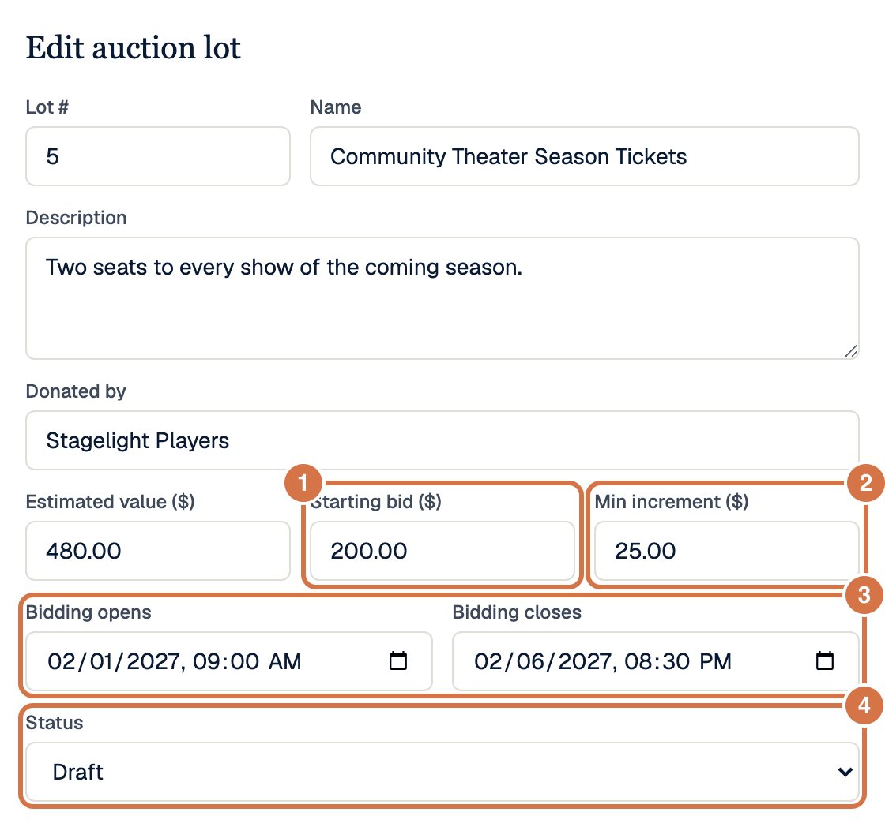
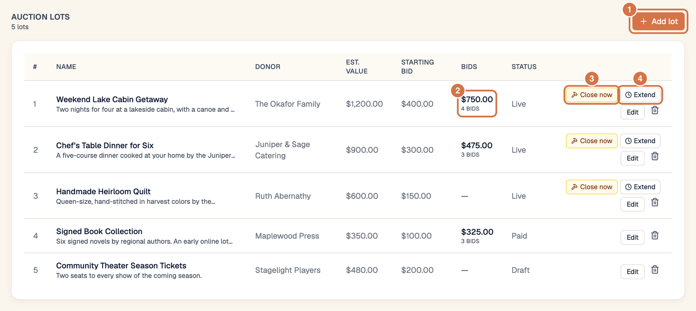
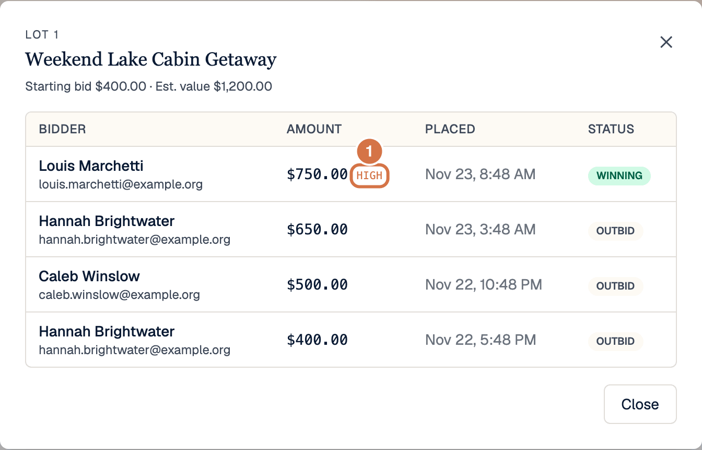

Enable **Manage auction items** for the event and open **Auction**. Before opening bidding, confirm the public page and payment setup are ready.

## Prepare a lot

1. Select **Add lot** and enter its number, name, description, donor, and estimated value as appropriate.
2. Set the starting bid, minimum increment, and bidding window.
3. Review the lot's other available settings and keep its **Status** on **Draft** while preparing it.
4. Save, inspect the lot, and change its **Status** to **Live** when ready to offer it for bidding. The **Status** menu also lets you set **Closed**, **Paid**, or **Unfulfilled** by hand.
5. Review the public auction page and the event's auction-preview setting. Bidders enroll with their name and email, verify a one-time code, and save a card before bidding; the name is what [Event Match](/data-management/event-match) shows if a winner has to be reconciled by hand.

<Frame caption="A lot's settings: (1) starting bid, (2) minimum increment, (3) bidding window, (4) Draft while you prepare it.">
  
</Frame>

On the public auction page, bidders select **Details** or the lot title to see the full description, photos, current and minimum next bid, and bidding window, and **Bid now** to bid. Enrolling is once per event: a bidder who returns in the same browser is recognized, and one who verifies their email again does not have to save a card a second time.

## Monitor and close bidding

Review the bids for the lot and its current status. Use **Extend** when you need a later closing time.

<Frame caption="The Auction tab: (1) Add lot, (2) the high bid and bid count open the lot's bids, (3) Close now, (4) Extend.">
  
</Frame>

<Frame caption="A lot's bids, highest first: (1) the current high bid.">
  
</Frame>

<Warning>
**Close now** ends bidding and requests a charge to the winning bidder's saved card. Check the lot and bids before confirming. This is a payment action, not merely hiding the lot.
</Warning>

Wait for the result after closing. A close request being accepted does not mean the winner's payment has completed. A lot whose winner is charged successfully ends as **Paid**. Check the final status and use [Event Match](/data-management/event-match) for an unmatched auction buyer.

## Troubleshooting

If a lot is missing publicly, check its status, bidding window, and the event's published/public settings. If closing or payment fails, note the lot and visible message, then choose **Support** in your avatar menu. Do not create a second lot or charge manually without reconciling the first attempt. Deletion is restricted to draft lots.
