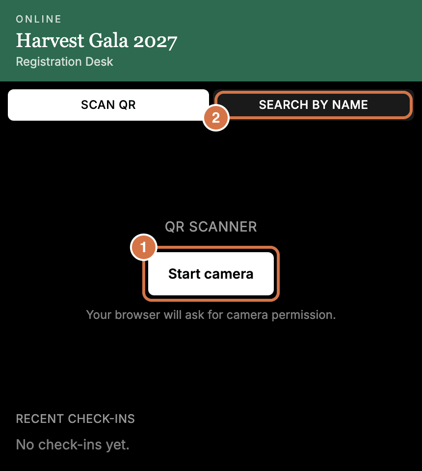
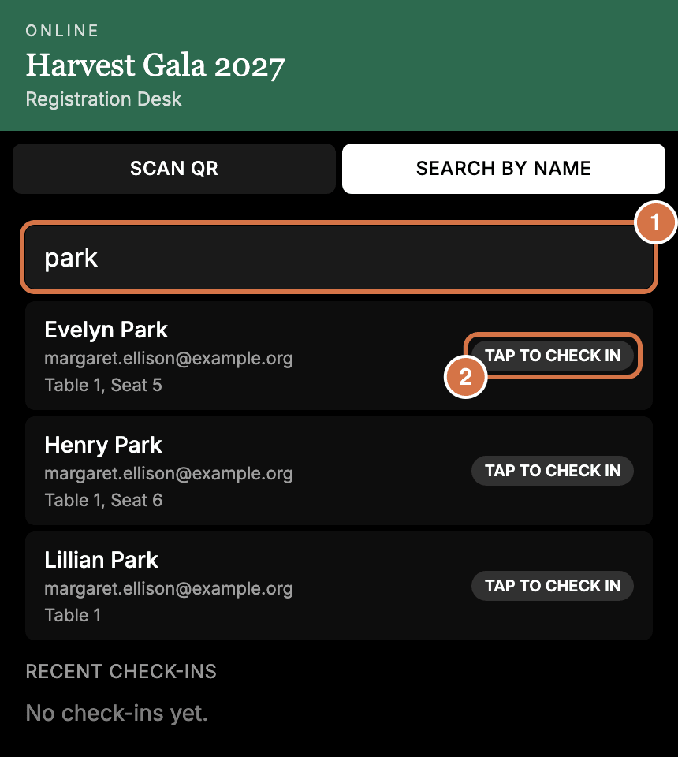
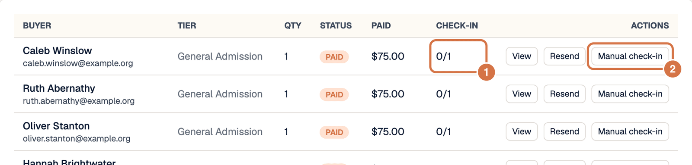

Check-in records that a ticket's admission has been used. Prepare your door team before guests arrive.

## Before doors open

1. Open the event's **Volunteers** tab and create the roles you need.
2. Enable check-in for the role that will run the door, assign volunteers, and send their private links.
3. Have each volunteer open their link on the device they will use. Keep these links private.
4. Confirm the device can load the page and use its camera. Perform a coordinated test with your organizer so you do not consume a guest's admission accidentally.

The private link provides access to the event's scanner without requiring a full CRM account. A CRM user's Volunteer role and an event volunteer assignment are different things.

## Scan a ticket

1. Open your private link in the device's browser using HTTPS.
2. Select **Start camera** and allow camera access.
3. Point the camera at the guest's QR code.
4. Read the result before admitting the guest.

<Frame caption="The volunteer scanner page: (1) Start camera, (2) Search by name.">
  
</Frame>

| Result | What to do |
| --- | --- |
| Checked in | Admit the guest for the recorded admission. |
| Already checked in | Ask the organizer to review the order before allowing another admission. |
| Ticket reissued | Ask for the replacement ticket; the previous QR no longer works. |
| Ticket voided | Ask the organizer to resolve the registration. |
| Saved for sync | The scan is queued offline; restore connectivity and check the eventual result. This is not server confirmation. |

A tier can allow multiple admissions per ticket. Follow the scanner's remaining-admission result rather than assuming every repeat scan is a duplicate.

## Find a guest without a QR code

Select **Search by name** to pause scanning and look up the guest. Review the holder/buyer information and ticket status, then select **Tap to check in** on the correct result. When the guest has been [seated](/events/seating), the result also shows their table, and their seat if they have one. If you cannot identify the ticket confidently, ask the organizer to open the registration.

<Frame caption="Search by name: (1) type a name or email, (2) Tap to check in on the correct guest.">
  
</Frame>

Staff can also use the event's **Registrants** table and its **Manual check-in** action. Refresh the guest list after recording attendance.

<Frame caption="The Registrants table: (1) admissions checked in out of tickets issued, (2) Manual check-in.">
  
</Frame>

## Camera and connection problems

- If a code won't scan, ask the guest to brighten their screen and show the whole code with its white border, or tilt a printed ticket away from glare. If it still won't read, use **Search by name**.
- Newer tickets carry a simpler QR code that is easier to scan. Older tickets still work. **Resend email** on the [registration](/events/registrants) sends the buyer the simpler code.
- Open the link in Safari or Chrome rather than an email app's built-in browser.
- Use the HTTPS link and allow camera access in browser settings.
- Close another app using the camera, then try again.
- Use name search when the camera is unavailable and you have connectivity.
- Reconnect before leaving the page if scans are queued. Review results after synchronization; an offline scan can later be rejected.

For a replacement QR or another confirmation email, see [Manage registrations](/events/registrants).
