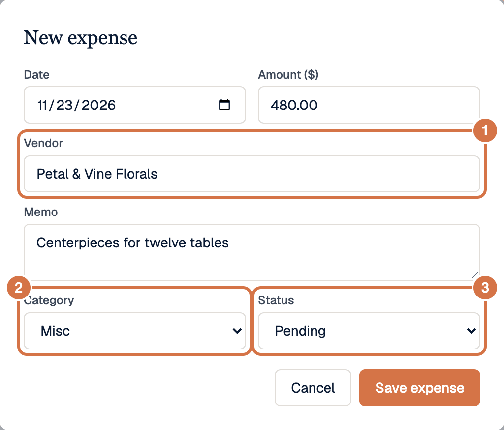
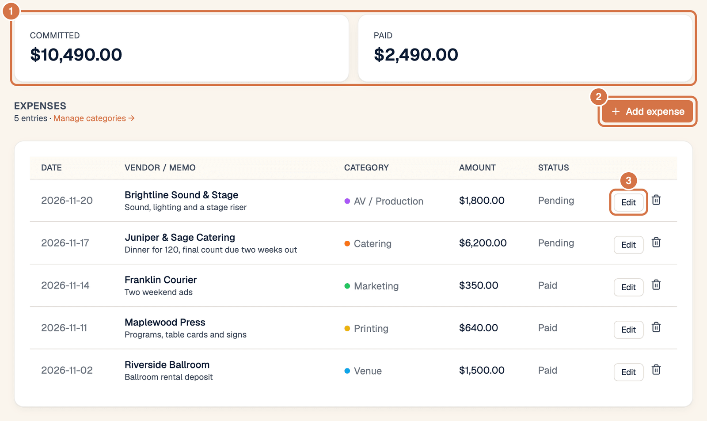

Enable **Track expenses** for the event and open **Expenses**. Prepare shared categories in [Lookup Tables](/data-management/lookup-tables).

## Record an expense

1. Choose **Add expense**.
2. Enter the vendor and optional memo.
3. Select the category, enter the amount, and set the **Date**.
4. In **Status**, choose **Pending** or **Scheduled** for a cost not yet paid, or **Paid** for a cost already paid.
5. Save and check the expense list and **Committed**/**Paid** totals.

<Frame caption="A new expense: (1) vendor, (2) category, (3) Status.">
  
</Frame>

<Frame caption="The Expenses tab: (1) Committed and Paid totals, (2) Add expense, (3) Edit an entry.">
  
</Frame>

Recording an expense tracks the cost; it does not send a payment to the vendor.

## Maintain the list

Use **Edit** to correct an entry. Review the event and expense before deleting a mistaken duplicate. Keep a consistent distinction between pending commitments and paid costs so the totals remain meaningful.

## Troubleshooting

If a category is missing, check the shared expense categories and Events availability. If the total differs from your bank records, compare statuses and dates and check for duplicates. Review the event's [reports](/reports/catalog) for the broader financial picture.
