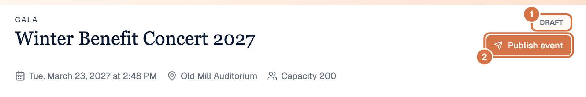
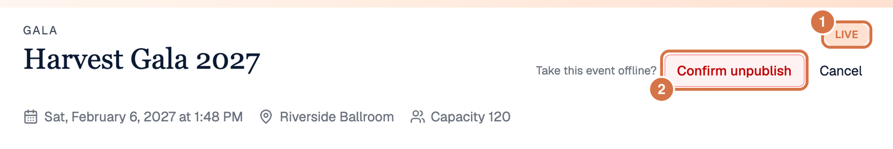

When an event is a **draft**, a **Publish event** button sits at the top of its detail page. Publishing makes the registration page and embeds public.

<Frame caption="A draft event: (1) its status, (2) Publish event.">
  
</Frame>

## Pre-flight checks

Before it goes live, Advocora confirms a few things. If anything's missing, a **Fix these before publishing** list appears under the button and names each item to fix:

<AccordionGroup>
  <Accordion title="A future start time" icon="clock">
    The start date and time must be in the future.
  </Accordion>

  <Accordion title="At least one active ticket tier" icon="ticket">
    Paid and RSVP events both need a tier. See [Ticketing](/events/ticketing).
  </Accordion>

  <Accordion title="Complete table tiers" icon="armchair">
    An active table tier needs **Offer tables** turned on and at least 2 seats. When guests pay, it also needs a price per seat, any seat sales end date set before the event starts (required to release unsold seats or charge the host), and, for release, a tier to release seats to. See [Offer tables](/events/tables).
  </Accordion>

  <Accordion title="A hero image (or color block)" icon="image">
    Upload a hero image, or enable **Allow color-block hero** on the Public page tab. See [Public page & emails](/events/public-page-and-emails).
  </Accordion>

  <Accordion title="A ready Stripe account (paid events)" icon="credit-card">
    Paid events need a Stripe account that's still connected and has finished setup—charges and payouts enabled. To choose one, open **Events**, select **Edit event** from the event's menu, and pick the **Stripe Connect account** under **Ticketing**. See [Payments](/settings/payments).
  </Accordion>

  <Accordion title="A gift designation and gift account" icon="hand-holding-heart">
    Every event needs a default **Designation** and **Gift account** so its gifts are recorded consistently. Set them under **Gift defaults** in **Edit event**. See [Create an event](/events/create-an-event).
  </Accordion>
</AccordionGroup>

Once everything passes, choose **Publish event**. The status changes to **live** and the event appears on its public page and any embeds.

## Taking an event offline

While an event is live, choose **Unpublish** and confirm. The status returns to **draft** and the event disappears from all public surfaces immediately.

<Frame caption="A live event after choosing Unpublish: (1) its status, (2) Confirm unpublish takes it offline.">
  
</Frame>

<Note>
  Events close themselves automatically once their time has passed—you don't need to unpublish a finished event. Closed events keep all their data.
</Note>

## Check the public result

After publication, copy the event's public link and open it while signed out. Confirm the title, date/time, venue, available ticket tiers, and checkout behavior. A published event can still have a tier outside its sale window or sold out.

If publication fails, resolve each listed requirement and try again. If the page is unavailable after success, refresh the event status and use the copied link rather than an older bookmarked address.
