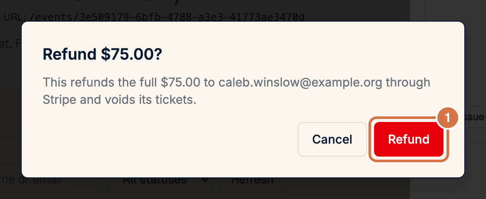

Use the registration's refund action to return an eligible online payment. The event registration screen offers a **full refund**.

## Before you begin

You need permission to manage event submissions. The registration must be **Paid**, have a paid amount above $0 and a Stripe payment associated with it, and have its connected payment account available. The refund is made from the account that collected the payment.

A **Paid** registration entered manually for cash, check, or an outside payment cannot be refunded through this action. Return that payment through the original payment method and coordinate the record correction with your administrator.

<Warning>
Refunding a registration voids all of its tickets and returns its full paid amount. Confirm the buyer and the whole order amount before continuing.
</Warning>

## Issue the refund

1. Open **Events**, choose the event, and open **Registrants**.
2. Search for the buyer and open the registration.
3. Check the buyer, ticket tier, quantity, and paid amount.
4. Select **Refund … (full)** at the bottom of the panel.
5. Read the confirmation showing the amount and buyer, then confirm.
6. Wait for the result. After success, refresh the list and confirm the registration is **Refunded** and its tickets are **Voided**.

The linked gift is updated too. When one checkout created several registrations, they share one gift: refunding one of them records a partial refund on that gift and leaves the other registrations paid.

A refund being recorded does not mean the money is already visible in the buyer's bank account. Do not promise an arrival date from the registration screen.

<Frame caption="The confirmation names the amount and the buyer. Select Refund (1) to issue it.">
  
</Frame>

## Refunds at a host's table

- Refunding a **guest** who paid reopens every seat on their registration.
- Refunding the **host** doesn't cancel the table or refund guests who signed up themselves. Guests added by name are on the host's registration, so their tickets are voided with it. The table is flagged **Host withdrawn**. See [Manage table hosts and guests](/events/table-hosts-and-guests).
- A host's charge for unsold seats is its own registration, separate from the one for the seats they took, so refund it separately. Refunding it doesn't put the seats back on sale: guests can still take them at no charge.

## Troubleshooting

| Problem | What to do |
| --- | --- |
| Refund unavailable | Check the registration status. Complimentary, cancelled, and already refunded registrations are not eligible here. |
| Nothing to refund | The registration was free. No money was collected, so there is nothing to return. If it can be removed, the panel offers **Delete registration** instead. A table host's registration can't be deleted until the table is cancelled. |
| No Stripe payment on file | This may be a manually recorded payment. Use the original payment method. |
| No connected account | Ask an administrator to review the event's payment setup. |
| Stripe refund failed | Preserve the error and registration details and use **Get support** if the payment/account issue is unclear. |
| Refund recorded on Stripe but local update failed | The money was returned but the registration still shows **Paid**. Select the refund again right away to finish the update; a prompt retry reuses the same refund. If it fails again, or if hours have passed, don't retry: use **Get support** so the refund can be checked in Stripe first. |

Do not delete a gift or reissue a ticket as a substitute for refunding a payment. For ordinary gifts, use the separate [gift refund procedure](/gifts/manage-gifts).
