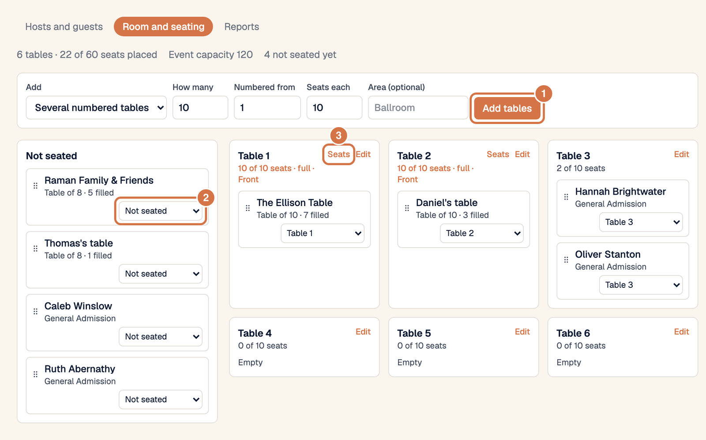
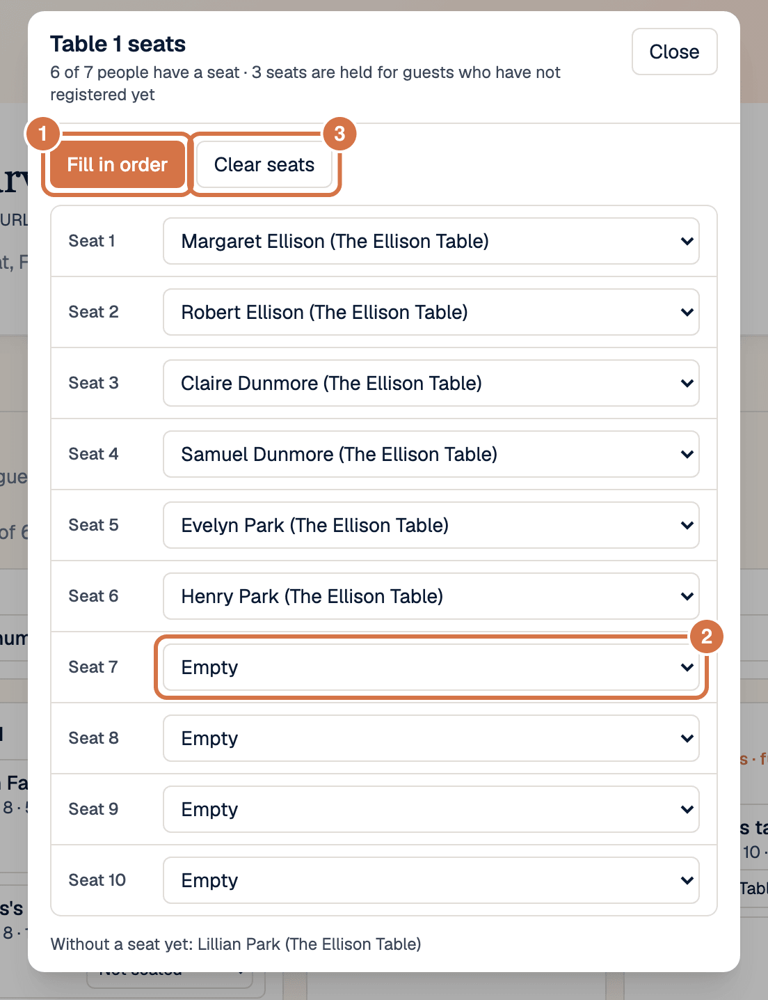
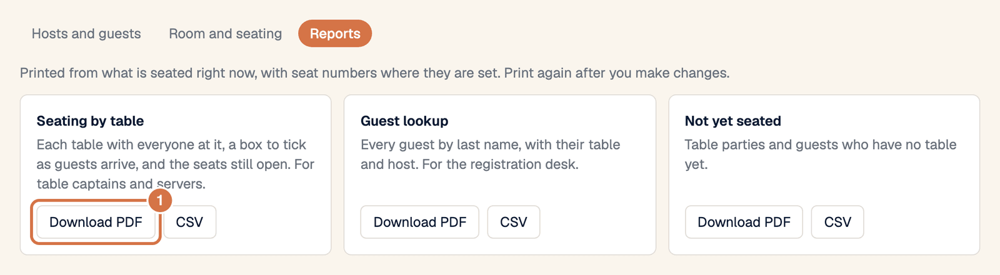

Use the **Room and seating** view to say which table in the room each group and guest sits at. Then print reports for table captains, servers, and the registration desk.

Two things are called a table here. A **host's table** is a group: a host and their guests. A **room table** is the physical table at the venue. You place hosts' tables at room tables.

## Before you begin

- The event needs **Offer tables** turned on. See [Offer tables at an event](/events/tables).
- Adding or changing room tables needs permission to edit events. Seating people needs permission to manage registrations. Anyone who can view events can download reports.
- To give guests specific seats, turn on **Designate seats** for the table's ticket tier under **Ticketing**. It's a choice per tier, so a head table can have designated seats while others don't.

## Set up the room

1. Open **Events**, choose the event, open **Tables**, then select **Room and seating**.
2. For a numbered run, keep **Several numbered tables** and enter **How many** (up to 200), **Numbered from**, and **Seats each** (up to 100). For example, 20 tables of 10 numbered from 1.
3. For a single table, choose **One named table** and enter the **Table name**, such as Head Table.
4. Optionally enter an **Area**, such as Ballroom.
5. Select **Add tables** or **Add table**.

Names can't repeat within an event. If any table in a run would repeat one, none of the run is added. When the event has a capacity, the summary line warns you if the room has more seats.

Select **Edit** on a room table to change its name, seats, or area, or to **Remove** it. Removing it returns everyone there to **Not seated**.

<Frame caption="Room and seating: (1) Add tables, (2) the menu that seats a card at a room table, (3) Seats, on a table with designated seats.">
  
</Frame>

## Seat people

The **Not seated** column lists hosts' tables and single guests who need a place.

1. Drag a card by its handle onto a room table, or choose the table from the menu on the card.
2. To move someone, drag the card to another table or choose a different one from the menu.
3. To unseat someone, drag the card back or choose **Not seated**.

- A host's table takes its **whole seat count**, including seats nobody has claimed, so the room isn't overbooked while the host is inviting.
- A room table can hold several hosts' tables and single guests. A move that doesn't fit is refused.
- A host's guests move together with the host's table. Guests who join later are seated with it automatically.

Guests then see their table on the ticket page and in confirmations sent afterwards, for example **Table 12**. Volunteers see it in the scanner's name search. Renaming a room table updates its tickets.

## Designate seats

The **Seats** link appears on a room table that holds a host's table from a tier with **Designate seats** on. Everyone at that room table can then be given a seat, including single guests.

1. Select **Seats**.
2. Select **Fill in order** to number everyone without a seat. Each group stays together with its host first, and people who already have a seat keep it.
3. To place one person, choose their name beside a seat. If someone is in that seat, the two swap; if the person you chose had no seat, the other is left without one.
4. To take someone out of a seat, choose **Empty**. **Clear seats** removes every seat number at the table.

<Frame caption="A table's seats: (1) Fill in order, (2) the menu beside a seat, (3) Clear seats.">
  
</Frame>

Seats held for guests who haven't registered have no ticket to number yet. Assign them after the guest registers. A guest moved to another table loses their seat number, and making a table smaller drops numbers above its new size.

## Print seating reports

On the **Tables** tab, select **Reports**, then **Download PDF** or **CSV**.

<Frame caption="Reports: each report downloads as a PDF (1) or a CSV.">
  
</Frame>

| Report | What it shows |
| --- | --- |
| **Seating by table** | Everyone at each table, check-in status, seats held for guests not yet registered, and open seats. The PDF has a box to tick |
| **Guest lookup** | Every guest by last name, with their table and host |
| **Not yet seated** | Hosts' tables and single guests with no room table |

Seat numbers are included when a room table has designated seats. The reports contain no contact or payment details. They show the seating at the moment you download them, so print again after changes.

## Check the result

Open a seated guest's registration and confirm the table, and any seat, on their ticket. Seating someone doesn't send an email.

## Troubleshooting

- **A group won't fit:** it needs its whole seat count. Use a larger room table, or reduce the group's seats under **Hosts and guests**.
- **You can't reduce a room table's seats:** move people off it first.
- **There's no Seats link:** check that someone is seated there and that a host's table there is on a tier with **Designate seats** on.
- **A table no longer has designated seats:** guests still hold numbers from before, which show on their tickets. Select **Clear seats**, or turn **Designate seats** back on for the tier.
- **An emailed ticket shows no table:** it was sent before seating. The ticket page opened from that email shows the current table.

## Related tasks

- [Manage table hosts and guests](/events/table-hosts-and-guests)
- [Check in event guests](/events/check-in)
- [Manage event registrations](/events/registrants)
