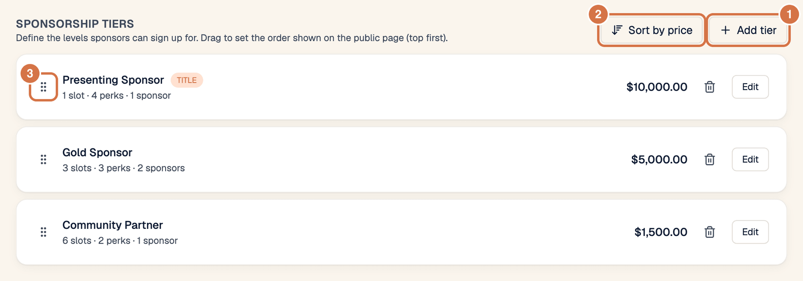
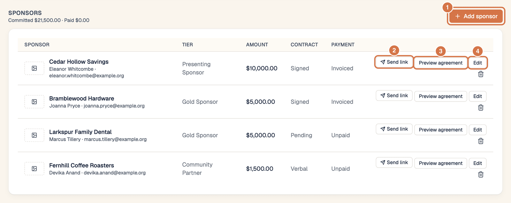
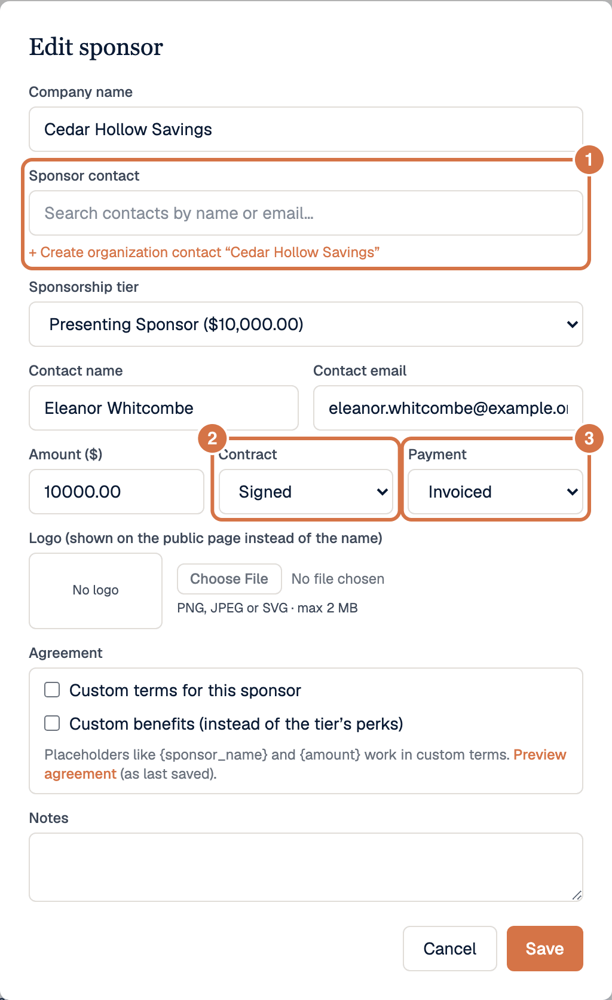

Enable sponsorships for the event, then open its **Sponsors** tab. Prepare the benefits and pricing before inviting sponsors.

## Before you begin

Editing sponsors requires permission to edit events. Recording, changing, or removing a sponsor's gift also requires permission to edit gifts. The event needs a **Designation** and **Gift account** under **Gift defaults** before a payment can be recorded.

## Set up sponsorships

1. Under **Sponsorship tiers**, select **Add tier** and enter its name, price, slots, and perks (one per line). Drag tiers to set the order on the public page, or select **Sort by price**.
2. Optionally choose a **Gift receipt template** for the tier. Otherwise receipts use the event's template. Receipts are never sent automatically.
3. Under **Sponsors**, select **Add sponsor** and enter the company name, tier, amount, and the contact name and email that should receive the private link.
4. In **Sponsor contact**, pick the contact record for this sponsor or select **Create organization contact**.
5. Set **Contract** (Verbal, Pending, or Signed) and **Payment** (Unpaid, Invoiced, or Paid), add a logo if you have one, and save.

<Frame caption="Sponsorship tiers: (1) Add tier, (2) Sort by price, (3) drag a tier to reorder it.">
  
</Frame>

<Frame caption="Sponsors: (1) Add sponsor, (2) Send link, (3) Preview agreement, (4) Edit.">
  
</Frame>

Contract progress and payment progress are separate. A signed commitment is not proof of money collected. Confirm payment before marking a sponsorship paid.

<Frame caption="Editing a sponsor: (1) Sponsor contact, (2) Contract, (3) Payment.">
  
</Frame>

## Record a sponsor's payment

Marking a sponsor **Paid** records the money as a gift, so it counts in the event's totals and the contact's giving history. It does not charge anyone.

<Warning>
Changing a sponsor back from **Paid**, or deleting the sponsor, deletes the gift the sponsorship recorded. An attached gift is kept: it is detached from the event and returned to its original designation and account. Deleting the event has the same effect on its sponsors' gifts.
</Warning>

1. Select **Edit** on the sponsor and set **Payment** to **Paid**.
2. Choose one:
   - **Record a new gift** — enter the **Gift date** and **Payment method**, plus a **Check number** for a check.
   - **Attach an existing gift** — choose one of the sponsor contact's gifts when the payment is already in Advocora. Refunded gifts, and gifts already tied to an event, membership, or another sponsor, aren't offered. The gift keeps its amount, date, and method but moves to the event's designation and account.
3. When recording a new gift, turn on **Email a receipt** only if you want one sent.
4. Save, then check the sponsor's payment status and the contact's giving history.

A paid sponsor flagged **No gift yet** or **Link a contact to record the gift** needs you to edit it and record or attach its gift.

Receipt templates can use `{sponsorship_tier}` and `{sponsor_name}`. See [Email templates](/email/templates).

## Prepare the agreement

The **Sponsor agreement** card holds the terms every sponsor signs. Edit the wording, insert placeholders such as `{sponsor_name}` and `{amount}`, select **Preview** to check a draft, then **Save terms**. **Reset to default wording** restores the standard text. Review the terms with your own counsel.

For one sponsor, select **Edit** and turn on **Custom terms for this sponsor** or **Custom benefits**. Use **Preview agreement** on the sponsor's row to see what they will be asked to sign.

<Warning>
Once a sponsor signs, their agreement's terms and benefits can't be changed. New event terms apply only to sponsors who haven't signed.
</Warning>

## Sponsor self-service

Select **Send link** to email the sponsor their private page. The sponsor needs a contact email. Send the link only to the intended sponsor; anyone who has it can open the page. A link works until 30 days after the event ends, or 30 days after you send it if the event has no end time. Sending a new link turns off the previous one.

From the page a sponsor can:

- **Upload a logo** (PNG, JPEG, or SVG, up to 2 MB).
- **Sign the agreement.** They read it, type their full legal name, agree to sign electronically, and enter a 6-digit code emailed to the sponsor's contact email. The code expires after 10 minutes. Both parties are emailed an identical signed copy, and staff can open it from **Signed agreement**.
- **Pay the sponsorship** by card or bank account. The charge is the full sponsorship amount, on the event's connected Stripe account.

Online payment is offered only when the sponsor is linked to a contact, the event's connected account can accept charges, and the event has a designation and gift account. When a payment succeeds, Advocora records the gift on the linked contact and marks the sponsor **Paid**. A bank payment can take several business days to clear, and the sponsor can't start another payment while it is processing. No Advocora receipt is sent automatically.

<Note>
A gift from an online payment is treated as attached: changing the sponsor from **Paid** detaches it but does not refund the sponsor.
</Note>

## Check the result

Review the sponsor record, payment state, logo, and public page. If a logo does not appear, confirm the event's sponsor-display setting as well as the saved asset.

## Troubleshooting

| Problem | What to do |
| --- | --- |
| Paid can't be saved | Link a sponsor contact, choose a payment method, and confirm the event has a designation and gift account. |
| You need permission to edit gifts | Ask your Owner or Super Admin to review your role. |
| The gift to attach isn't listed | Confirm it belongs to the linked contact and isn't refunded or tied to something else. |
| The sponsor can't sign | Add a contact email; the signing code is sent there. |
| The sponsor sees no payment form | Check the linked contact, the event's payment account, and gift defaults. |
| The link no longer opens | Select **Send link** to send a new one. |

For an incorrect amount or payment state, investigate the underlying payment before editing the commitment. Choose **Support** in your avatar menu and include the event and sponsor name if the records disagree.
