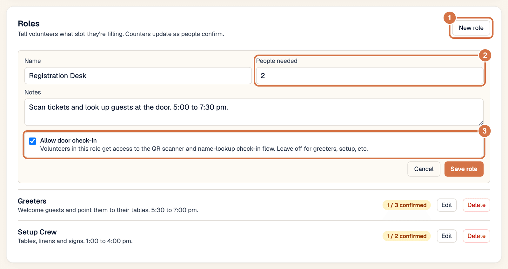
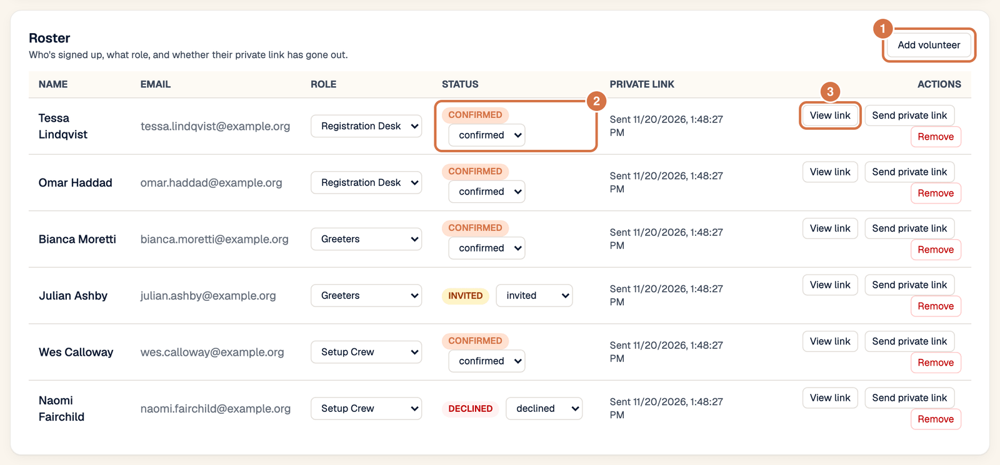
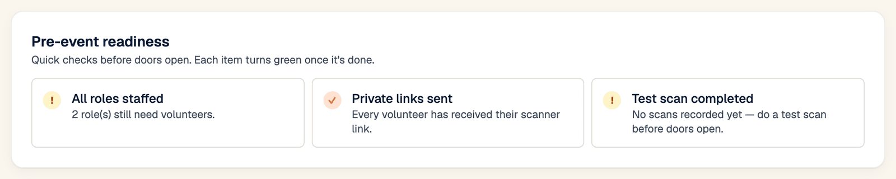

Enable **Coordinate volunteers** on the event and open **Volunteers**.

## Build the roster

1. In **Roles**, select **New role** for each job you need, such as registration desk or greeting.
2. Enter the **Name** and **People needed** for each role, and add **Notes** if they help.
3. Turn on **Allow door check-in** only for roles that should admit guests.
4. Add volunteers and assign their roles. Keep assignment status current as people confirm or become unavailable.
5. On the roster, select **View link** to open a volunteer's private link. Copy it, or use **Send email too** in that dialog when an email is available. **Send private link** on the roster emails it without opening the dialog.
6. Review **Pre-event readiness** and have the door team test their setup.

<Frame caption="Roles, with one open for editing: (1) New role, (2) People needed, (3) Allow door check-in.">
  
</Frame>

<Frame caption="The roster: (1) Add volunteer, (2) assignment status, (3) View link opens the volunteer's private link.">
  
</Frame>

<Frame caption="Pre-event readiness shows what is still to do before doors open.">
  
</Frame>

A private link gives event-specific access to the scanner. It is different from inviting a person as a CRM user under Team & access.

## On the day

Have the door team open their links and follow [Check in guests](/events/check-in). Keep an organizer available to resolve voided, reissued, or already-used tickets.

## Troubleshooting

If the page says **You're not on door check-in**, review the volunteer's role assignment and its check-in setting. If an email does not arrive, check the address or provide the private link securely. For camera errors, use the browser and permission steps in the check-in guide.
