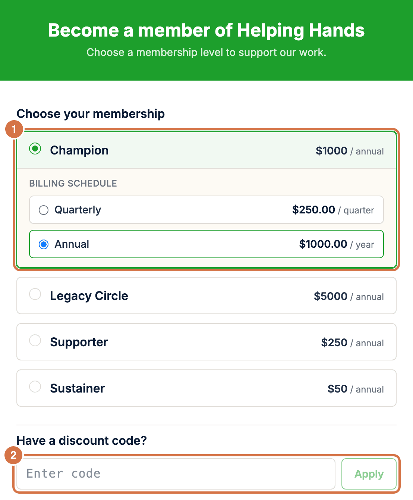
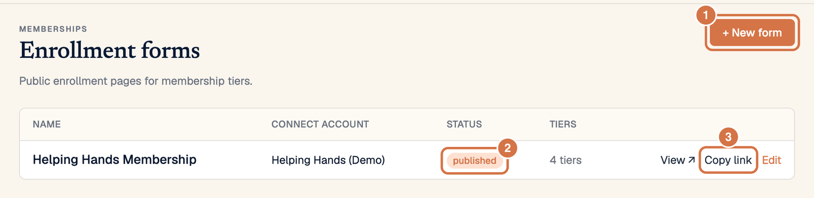
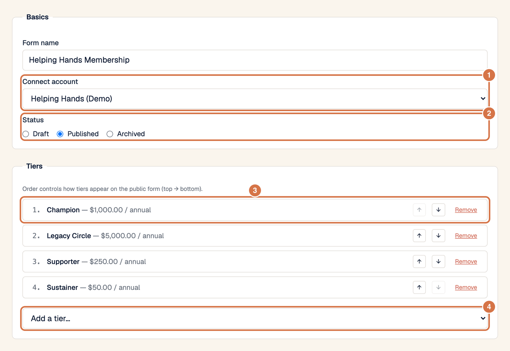

Membership forms—called **Enrollment forms** in the app—let supporters join one of your membership tiers and pay for it online.

<Note>
  Memberships is an optional module. If you don't see **Memberships** in the sidebar, it isn't enabled for your organization. You'll also need at least one membership tier set up first.
</Note>

## What members fill in

The public enrollment page asks for the member's **first name**, **last name**, and **email**, plus a required **mailing address** (street, city, state, ZIP) — the same fields a donation form requires. The address is saved as the contact's primary mailing address. Forms with political-compliance fields turned on also require **employer** and **occupation**.

If the chosen tier covers more than one person, the supporter must name at least one other person before they can pay. If the tier and billing schedule accept a [discount code](/settings/memberships#offer-a-discount-code), the form shows **Have a discount code?** and, once a valid code is applied, what they'll pay today and afterwards.

<Frame caption="The public enrollment page: (1) the chosen tier and its billing schedule, (2) Have a discount code?">
  
</Frame>

## Before you build

Set up your **tiers** first under **Memberships → Tiers**. A tier is a membership product—"Individual," "Family," "Gold"—with a price, billing interval, and optional member limit. See [Membership tiers](/settings/memberships).

## Create a form

Choose **\+ New form** under **Memberships → Enrollment forms**, then pick the **Stripe Connect account**, the **tiers** to offer, branding, and receipt templates. The forms table shows each form's account, status, and number of tiers.

<Frame caption="Enrollment forms: (1) + New form, (2) the form's status, (3) Copy link for the public page.">
  
</Frame>

## How members understand the terms

| Term | Meaning |
| --- | --- |
| **Tier** | A membership product (e.g., "Family") |
| **Membership** | One supporter's enrollment in a tier |
| **Member** | An individual covered by a membership (a Family membership can cover several) |

When a tier covers more than one person, the form says so and requires the supporter to name at least one other person from their household. See [Couple and family memberships](/memberships/couples-and-families).

## Receipts and renewals

Membership forms send a **Membership Receipt** on signup and on each renewal, and each tier can send a **Membership Renewal Reminder** before a term ends, with [separate templates](/settings/memberships#choose-renewal-reminders) for offline and Stripe members. Set those up as [transactional templates](/email/templates).

<Warning>
  Like donation forms, membership forms need a ready Stripe Connect account to take payment. See [Payments](/settings/payments).
</Warning>

## Configure and publish

1. Enter the form name, select the Connect account, and keep the form in Draft while preparing it.
2. Select the tiers to offer and put them in the desired order. At least one tier is required for publication.
3. Review the employer/occupation option, branding, logo, background, thank-you text, and the receipt template.
4. Add allowed embed origins if you will use the form on another website.
5. Save, set Published, save again, and inspect the copied public link while signed out.

<Frame caption="An enrollment form: (1) Connect account, (2) Status, (3) a tier, with arrows to reorder it and Remove, (4) add a tier.">
  
</Frame>

## Verify an enrollment

Check the selected tier, payment schedule, primary individual, covered members, and receipt separately. If payment needs attention, investigate the existing enrollment before creating another. A sign-up whose contact match is uncertain also appears in [Membership Match](/data-management/membership-match). For manual entry, see [Manage memberships](/memberships/manage-members).
