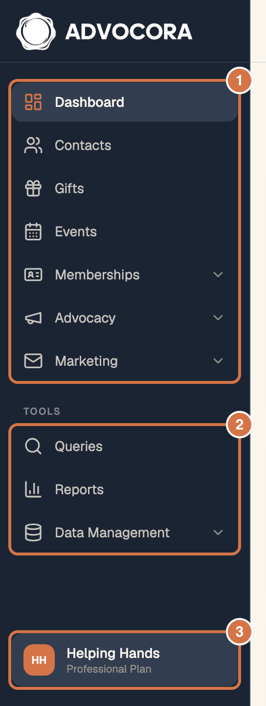
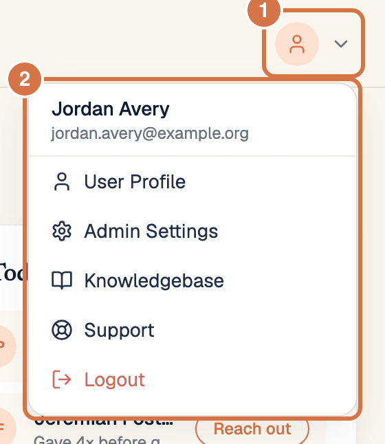

Every screen in Advocora shares the same frame: a navigation rail on the left, a slim bar across the top, and your work in the middle. Once you know where things live, you can get anywhere in a click or two.

## The sidebar

The dark rail on the left is your main map. It's grouped into two sections:

<CardGroup cols={2}>
  <Card title="Main" icon="compass">
    **Dashboard**, **Contacts**, **Gifts**, **Events**, **Memberships** (when enabled), **Advocacy** (when enabled), and **Marketing** (email)—the places you'll spend most of your day.
  </Card>

  <Card title="Tools" icon="toolbox">
    **Queries**, **Reports**, and **Data Management**—for finding records, pulling numbers, and keeping data tidy.
  </Card>
</CardGroup>

Items with a chevron (**Memberships**, **Marketing**, **Data Management**) expand into a submenu. The item you're on is highlighted, and your organization's name sits at the bottom of the rail.

<Frame caption="The sidebar: (1) Main, (2) Tools, (3) your organization's name.">
  
</Frame>

<Note>
  You'll only see what your role and your organization's plan allow. If a teammate sees **Events** or **Memberships** and you don't, that feature may be turned off for your account or not enabled for your organization.
</Note>

## The account menu

Click your avatar in the top-right corner for:

- **User Profile** — your name, photo, password, and security settings
- **Admin Settings** — your organization's configuration (if you have access)
- **Knowledgebase** — opens this help center in a new tab
- **Support** — send a question or problem report
- **Logout**

<Frame caption="The account menu: (1) your avatar, (2) the menu it opens.">
  
</Frame>

Advocora has one standard look for everyone. Display choices you saved earlier no longer apply.

## On smaller screens

On a phone or narrow window, the sidebar tucks away. Tap the menu icon in the top-left to slide it open, and tap anywhere outside it to close.
