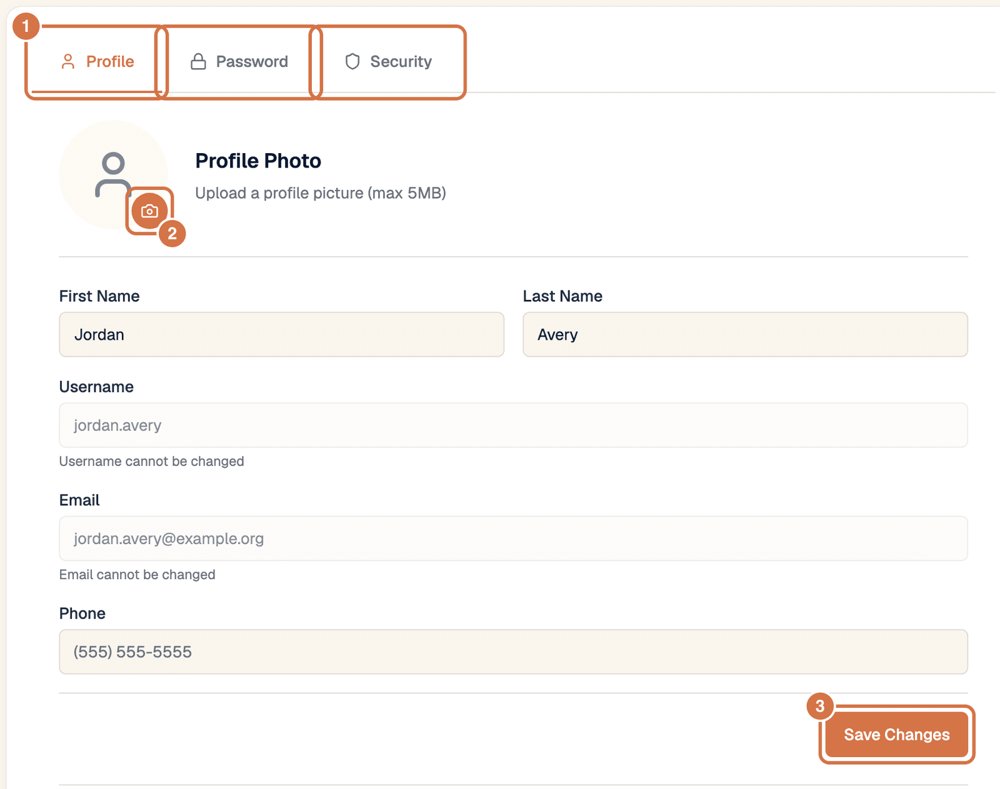
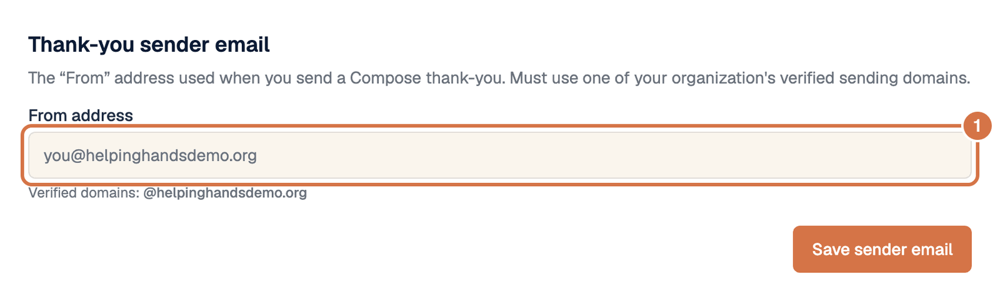
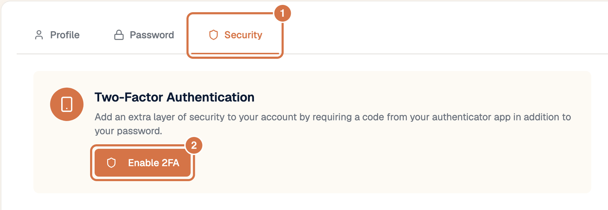

Open **User Profile** from the account menu (top-right avatar). It has three tabs: **Profile**, **Password**, and **Security**.

## Profile

Update your **First name**, **Last name**, and **Phone**, then choose **Save Changes**. You can also upload a profile photo (up to 5 MB) using the camera icon on your avatar.

<Frame caption="User Profile: (1) the three tabs, (2) the camera icon, (3) Save Changes.">
  
</Frame>

<Note>
  **Username** and **Email** are shown but can't be changed here—contact an administrator if either needs to change.
</Note>

### Thank-you sender email

Further down the Profile tab, set the **From address** used when you send a _Compose thank-you_ from a donor's record. It must use one of your organization's verified sending domains.

<Frame caption="Thank-you sender email: (1) the From address.">
  
</Frame>

<Warning>
  If you see "Your organization has no verified sending domain yet," an administrator needs to add one under **Settings → Sending domains** before you can set a sender address. See [Sending domains](/settings/sending-domains).
</Warning>

## Password

On the **Password** tab, enter your current password, then your new password twice. New passwords must be at least 8 characters. Each field has a show/hide toggle.

## Security: two-factor authentication

The **Security** tab controls **two-factor authentication (2FA)**—an extra code from an authenticator app at sign-in.

<Frame caption="Two-factor authentication: (1) the Security tab, (2) Enable 2FA.">
  
</Frame>

<Steps>
  <Step title="Choose Enable 2FA">
    You'll be taken to the setup screen.
  </Step>
  <Step title="Scan the QR code">
    Use an authenticator app (such as Google Authenticator, 1Password, or Authy) to scan the code.
  </Step>
  <Step title="Enter a verification code">
    Confirm the 6-digit code from your app to finish.
  </Step>
</Steps>

Once enabled, you'll see a badge showing the method. To turn it off, choose **Disable 2FA** and confirm.

<Tip>
  Two-factor authentication is the single best way to protect your supporters' data. We strongly recommend turning it on.
</Tip>
