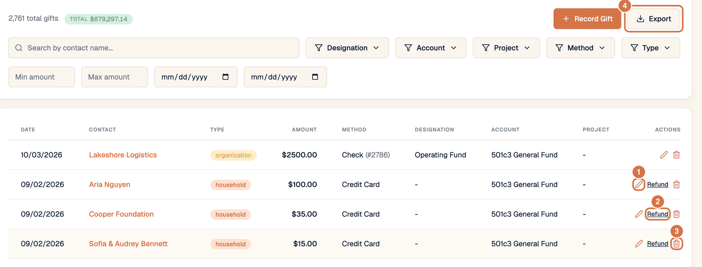
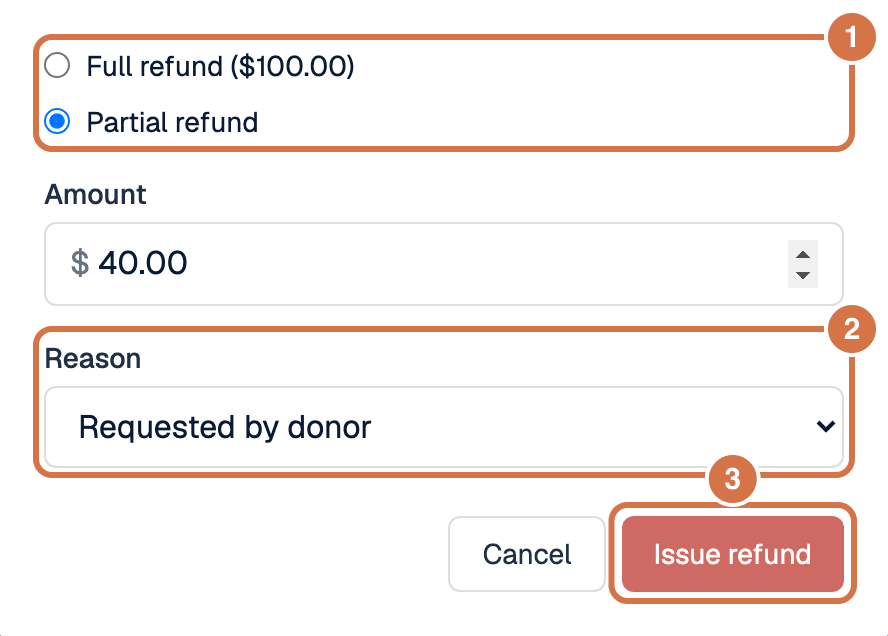
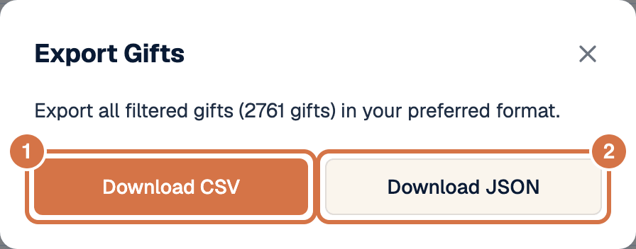

The actions on the right of each gift row depend on your role. Here's what each one does.

<Frame caption="The All gifts table: (1) the pencil edits a gift, (2) Refund, on card gifts charged through Stripe, (3) the trash deletes a gift, (4) Export.">
  
</Frame>

## Edit a gift

Choose the **pencil** icon to change a gift's amount, date, method, designation, account, or check number. Save when you're done.

## Refund a gift

A **Refund** link appears only on card gifts that were charged through Stripe and haven't already been refunded.

<Steps>
  <Step title="Open the refund dialog">
    Choose **Refund** on the gift row (or **Refund this gift** when editing). The **Refund donation** dialog opens.
  </Step>
  <Step title="Choose full or partial">
    Pick **Full refund** for the whole amount, or **Partial refund** and enter a smaller amount (it can't exceed the original gift).
  </Step>
  <Step title="Pick a reason">
    Choose **Requested by donor**, **Duplicate charge**, **Fraudulent**, or **Other**.
  </Step>
  <Step title="Issue refund">
    Choose **Issue refund**. Stripe processes it and the gift updates here automatically—usually within a few seconds.
  </Step>
</Steps>

<Frame caption="The Refund donation dialog: (1) Full refund or Partial refund, with the amount for a partial one, (2) the reason, (3) Issue refund.">
  
</Frame>

<Note>
  Refunds are handled by Stripe, so they only apply to card gifts paid through Advocora. Cash, check, and other manually recorded gifts can be edited or deleted, but not refunded.
</Note>

## Delete a gift

Choose the **trash** icon. Because this can't be undone, you'll review a summary of the gift and must type **DELETE** to confirm.

<Warning>
  Deleting a gift is permanent. If a card gift was refunded, the refund is recorded automatically by Stripe—you don't delete a gift to refund it.
</Warning>

## Exporting gifts

Choose **Export** above the table to download your gifts as **CSV** or **JSON**. The export includes every gift that matches your current filters, so filter first to get exactly the set you want.

<Frame caption="The export dialog: (1) Download CSV, (2) Download JSON.">
  
</Frame>

<Tip>
  Exporting is permission-gated. If you don't see the **Export** button, ask an administrator to enable gift export for your role.
</Tip>

## Check corrections against payments

Editing a gift's CRM amount or deleting its record is different from changing a payment. Confirm the Stripe payment/refund status separately. After a refund, inspect the recorded refund amount and donor history before taking another action.

If an action fails after the payment provider may have processed it, choose **Support** in your avatar menu and include the gift and transaction details before retrying. For event ticket payments, follow [Refund an event registration](/events/refund-a-registration).
