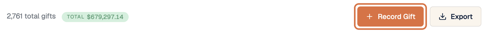
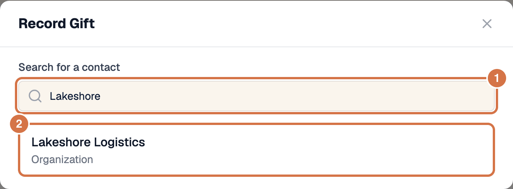
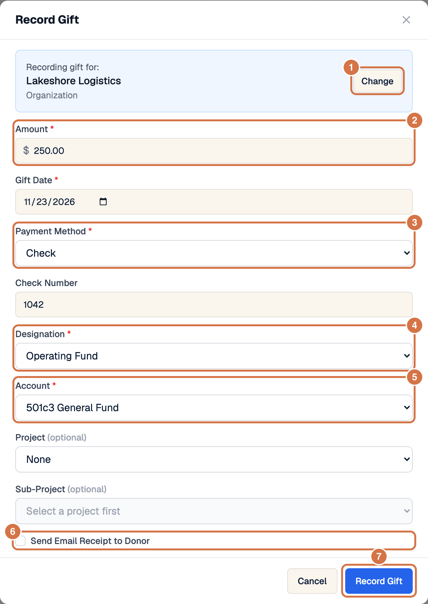

Use **Record Gift** to log a contribution you received—cash, a check, a stock transfer, an in-kind gift, or a card payment taken elsewhere.

<Note>
  The **Record Gift** button appears if your role allows creating gifts. Online donations made through a [donation form](/forms/donation-forms) are recorded automatically—you don't need to enter those by hand.
</Note>

## Step by step

<Steps>
  <Step title="Open Record Gift">
    On the **Gifts** page, choose **Record Gift**.
  </Step>
  <Step title="Find the contact">
    Type at least two characters of the contact's name and pick them from the results. Choose **Change** later if you need a different contact.
  </Step>
  <Step title="Fill in the gift">
    Complete the form (required fields are marked):

    - **Amount** (required)
    - **Gift Date** (required)
    - **Payment Method** (required) — Credit Card, Cash, Check, ACH, In-Kind, Stock, or Unknown
    - **Check Number** — appears only when the method is Check
    - **Designation** (required) — what the gift is for
    - **Account** (required) — where it's recorded
    - **Project** and **Sub-Project** (optional) — choose a project before a sub-project
  </Step>
  <Step title="Optionally send a receipt">
    Tick **Send Email Receipt to Donor** to email the donor a receipt on save.
  </Step>
  <Step title="Record Gift">
    Choose **Record Gift** to save.
  </Step>
</Steps>

<Frame caption="Record Gift sits above the table on the Gifts page, beside Export.">
  
</Frame>

<Frame caption="Finding the contact: (1) type at least two characters of the name, (2) pick the contact from the results.">
  
</Frame>

<Frame caption="The gift form: (1) Change picks a different contact, (2) Amount, (3) Payment Method, with Check Number below it for a check, (4) Designation, (5) Account, (6) the email receipt checkbox, (7) Record Gift.">
  
</Frame>

## Payment methods

| Method | Use it for |
| --- | --- |
| **Credit Card** | Card payments taken outside an online form |
| **Cash** | Cash received |
| **Check** | Checks—enter the **Check Number** when prompted |
| **ACH** | Bank transfers |
| **In-Kind** | Donated goods or services |
| **Stock** | Securities transfers |
| **Unknown** | Gifts where you don't know how the donor paid. Imported gifts with no payment method are recorded this way. |

## Foundation gifts and passthrough givers

When the contact is a **Foundation**, an optional **Passthrough Giver** field appears. Use it when a gift was directed by a specific person—such as from a donor-advised fund. If you set one, the checkbox reads **Send Email Receipt to Passthrough Giver** and the receipt goes to that person's email instead of the foundation's.

<Tip>
  **Designation** and **Account** are fixed lists, so you choose from them rather than typing a new value. Manage the lists under [Lookup tables](/data-management/lookup-tables).
</Tip>

<Warning>
  Receipts are best-effort: if your organization hasn't set up a receipt template for that account, no email is sent—but the gift is still recorded. Set up receipt templates under [Email templates](/email/templates).
</Warning>

## Check the saved gift

Open the contact's giving history and confirm the date, dollar amount, payment method, designation, and account. Recording a manual Credit Card gift does not charge a card. Before manually entering an online donation, check whether it is already recorded or awaiting matching.

If a receipt was requested but did not arrive, confirm the recipient and template separately. Do not record the gift a second time to resend a receipt.
