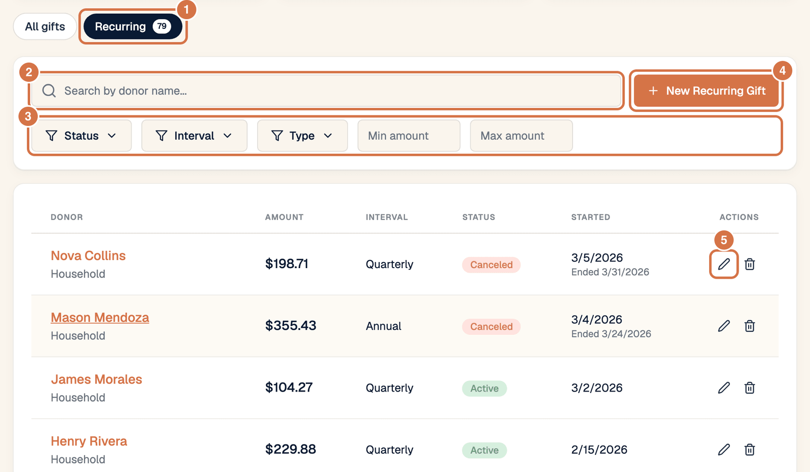
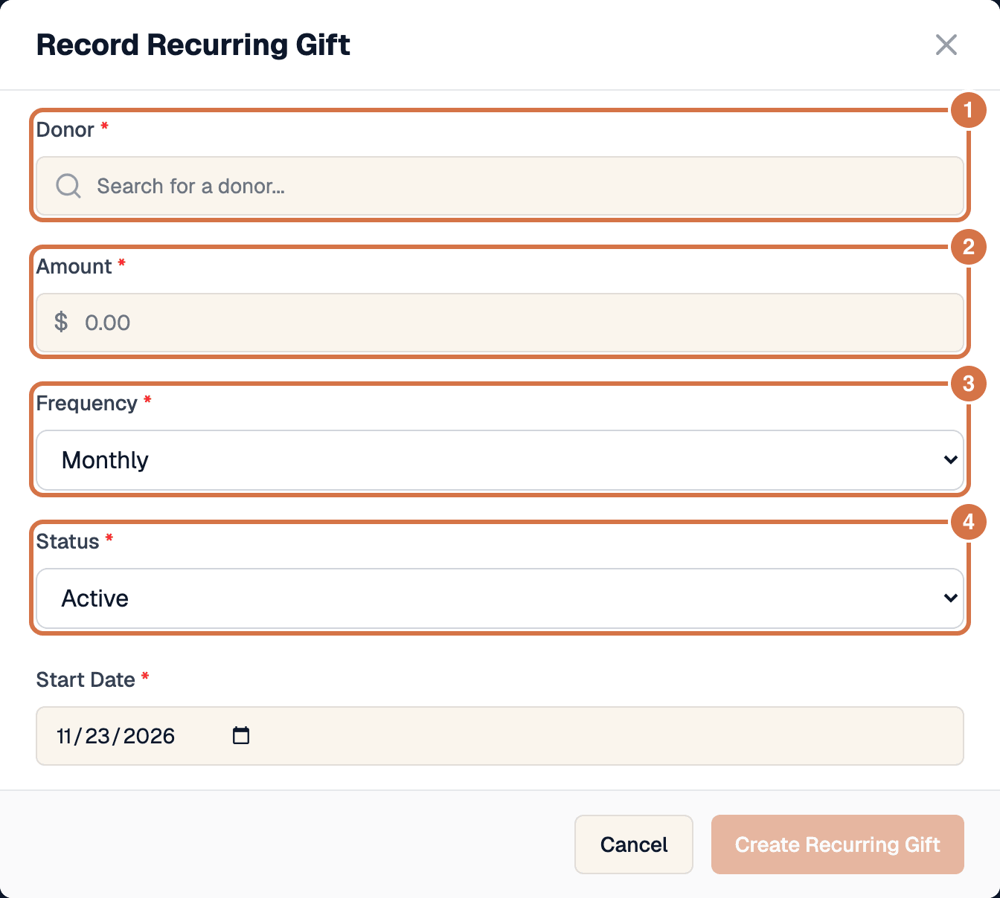

The **Recurring** tab on the Gifts page lists every ongoing subscription. A badge on the tab shows how many are currently active.

## Reading the list

Each row shows the **donor**, **amount**, **interval**, **status**, when it **started**, and (if it ended) when. You can search by donor name and filter by status, interval, and contact type.

<Frame caption="The Recurring tab: (1) the tab and its active count, (2) search by donor name, (3) filters, (4) New Recurring Gift, (5) the pencil edits a recurring gift.">
  
</Frame>

### Statuses

| Status | How to interpret it |
| --- | --- |
| Active | The recurring record is active. Check the payment subscription for actual billing. |
| Paused | The record is paused; confirm the payment-provider state before promising no charges. |
| Canceled | The recurring arrangement has ended or been marked cancelled. |

A manually entered recurring record does not collect a card or create a paid subscription by itself.

### Intervals

Recurring gifts run **Monthly**, **Quarterly**, or **Annually**.

## Add a recurring gift

Choose **New Recurring Gift**, then:

<Steps>
  <Step title="Choose the donor">
    Search and select the contact.
  </Step>
  <Step title="Set the amount and frequency">
    Enter the **Amount** and pick a **Frequency** (Monthly, Quarterly, or Annual).
  </Step>
  <Step title="Set the status">
    Start it as **Active** or **Paused**.
  </Step>
  <Step title="Save">
    The gift appears in the Recurring tab and counts toward your active total.
  </Step>
</Steps>

<Frame caption="The new recurring gift form: (1) the donor, (2) Amount, (3) Frequency, (4) the status.">
  
</Frame>

## Editing and canceling

Use the **pencil** to change amount, frequency, or status. If you set the status to **Canceled**, you'll also set the cancellation date.

<Note>
  When a recurring gift is managed through **Stripe**, a banner says so and shows the subscription ID. For those, use **Cancel Subscription via Stripe** to stop future charges properly—choose **end at period end** (let the current period finish) or **cancel immediately**.
</Note>

<Tip>
  Donors can manage their own recurring gift—amount, card, or cancellation—without contacting you. See [the donor self-service portal](/gifts/donor-portal).
</Tip>
