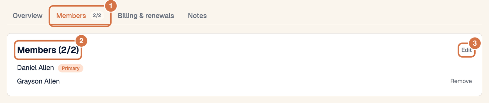

A tier can cover more than one person. A Couple tier covers two, a Family tier might cover four or five. The limit is set on the tier, under **Max members per membership**.

Everyone covered gets their own record in Advocora, so you can email them, see them on the household, and count them properly in reports.

## When someone joins online

If the tier they pick covers more than one person, the enrollment form says so—"Covers up to 2 people"—and a **Who's covered** section appears after their own details.

They're listed first as the primary member, with a row ready for the next person. Each person needs a first and last name, and an email if they have one.

<Note>
  The email is optional on purpose. A spouse or a child often doesn't have one, and requiring it would leave you adding them by hand afterwards.
</Note>

A few things worth knowing:

- **At least one other person is required.** A supporter can't pay for a Couple or Family tier until they name someone else from their household. They don't have to fill every place: a tier that covers four accepts two people.
- **Two people with the same name need an email.** If a person's name matches someone already listed, the form asks for an email so the two can be told apart. The same email can't be used twice.
- **Names are required once a row is started.** A half-filled row is refused rather than quietly dropped, so nobody gets lost between the form and your records.
- **Switching to a smaller tier trims the extra rows**, and the section disappears entirely for a single-person tier.

When the payment goes through, the membership is created with everyone already attached. The thank-you message names who's covered.

This rule applies to the public form and its embed. When **you** add a membership in Advocora, you can save it with just the primary member and add the others later.

## Adding someone afterwards

Open the membership from **Memberships → Members** and go to the **Members** tab. The heading shows how full it is—"Members (1/2)"—and tells you how many more the tier allows.

1. Choose **\+ Add member**.
2. Search for the person by name or email.
3. If they're already in Advocora, pick them.
4. If they aren't, choose **Add someone who isn't in the CRM yet** and enter their name. An email is optional. They're created in this membership's household.

<Frame caption="The Members tab: (1) the tab, (2) the heading shows how full the membership is, (3) Edit. + Add member sits beside Edit while the tier has room.">
  
</Frame>

You can also swap one covered person for another, or move the primary-member role, from **Edit** on the same tab.

## Who ends up where

When **you** add a member and the email matches someone already in Advocora, that existing record is used rather than a duplicate being made—and their household doesn't change. They simply also belong to this membership as well.

When a **supporter** adds someone through a public enrollment form, Advocora only reuses a record that already sits in that supporter's own household. Anyone else is created fresh. This keeps a public form from reaching into the rest of your database, and it means an online signup occasionally creates a second record for someone you already had. [Contact merge](/data-management/contact-merge) tidies those up.

## Removing someone

Removing a member unlinks them from the membership. It does not delete the person—their contact record, giving history, and email history all stay. The primary member can't be removed; move that role to someone else first, or cancel the membership.

## Troubleshooting

- **The form didn't ask for other members.** The tier's member limit is 1. Raise it under **Memberships → Tiers**, then check the form still offers that tier.
- **Only one person is on a couple's membership.** It may have been added by your team, imported, or bought before the form required a second person. Add them from the membership's **Members** tab.
- **A supporter can't finish a couple's signup.** They need to name at least one other person, or choose a tier for one.
- **"This membership already has its tier maximum."** The roster is full. Either remove someone, or move the membership to a tier that covers more people.
- **A member appears twice.** Two records for the same person. Use [Contact merge](/data-management/contact-merge).
- **Moving to a smaller tier is refused.** A membership can't cover more people than its tier allows. Remove members down to the new limit first.
