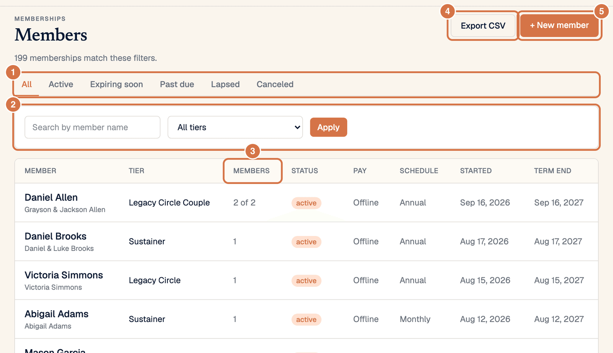
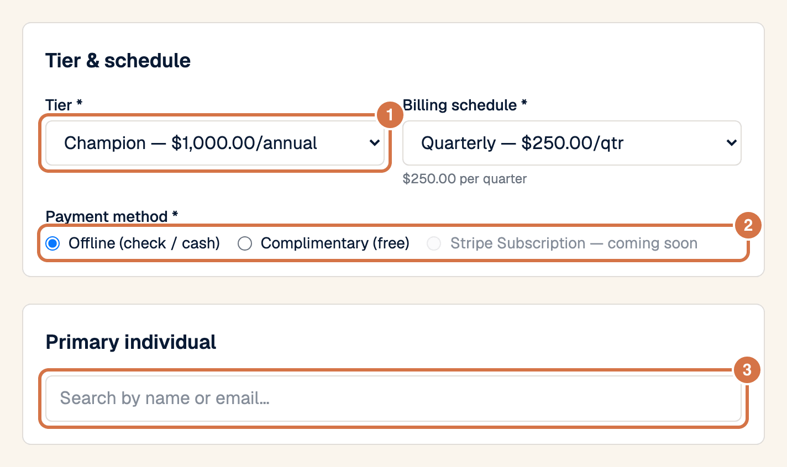
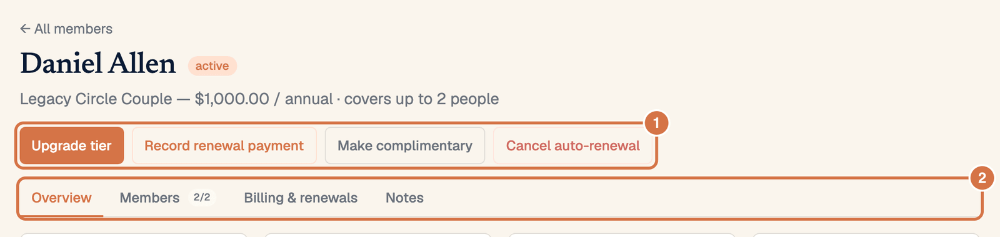

Open **Memberships → Members** to find an enrollment. A contact can contain several individuals; select the actual person who should be the primary member.

## Find an enrollment

Tabs across the top narrow the list to **Active**, **Expiring soon**, **Past due**, **Lapsed**, or **Canceled**; search and the tier filter narrow it further. The **Members** column shows how many people each membership covers against what its tier allows—so a household tier sitting at 1 of 2 is easy to spot. **Export CSV** downloads exactly what the current filters show.

<Frame caption="The Members list: (1) the status tabs, (2) search and the tier filter, (3) the Members column, (4) Export CSV, (5) the new-member action.">
  
</Frame>

## Add a membership manually

1. Open the member list and choose the new-member action.
2. Under **Tier & schedule**, choose the tier, the billing schedule, and the **Payment method**: **Offline (check / cash)** or **Complimentary (free)**. A complimentary membership can have an expiry date; leave it blank for one that doesn't end.
3. Under **Primary individual**, search by name or email and select the correct person and household.
4. Add any **Additional members** permitted by the tier. Check the selected roster rather than assuming every household member is included.
5. Under **Term details**, set **Started on**. The term end is worked out from that date and the tier's term length. Add a note if you need one, then choose **Create membership**.
6. Open the resulting membership to confirm the primary individual, covered members, term, and linked gifts.

<Frame caption="Adding a membership: (1) the tier, (2) Payment method, (3) search for the Primary individual.">
  
</Frame>

If someone you're adding isn't in Advocora yet, choose **Add someone who isn't in the CRM yet** and enter their name—an email is optional. They're created in the primary member's household, so you don't have to leave and build a contact first. See [Couple and family memberships](/memberships/couples-and-families).

Manual record entry should not be treated as proof of a collected online payment. Use an [enrollment form](/forms/membership-forms) for supporter self-service payment and verify the payment outcome separately.

## When a household already has a membership

When a new membership takes effect, Advocora closes the household's earlier active or past-due membership: it moves to **Lapsed**, and its term end is cut to the new start date (a term that ended sooner keeps its own end date). This happens when you add a membership by hand, when an active or past-due membership is imported, and when an online enrollment is paid. It only closes memberships that started on or before the new one.

<Warning>
  An earlier membership that bills through a Stripe subscription is **not** closed. It stays active and the card keeps being charged until its subscription is canceled in Stripe. Before you add a replacement, check for one and cancel its subscription in your Stripe account.
</Warning>

To move someone to a higher tier without creating a second membership, use **Upgrade tier** instead.

## Review an existing membership

Search the member list, open the enrollment, and review its status and term before making changes. Check linked gifts when resolving a payment question. For an externally managed payment subscription, confirm the actual subscription status before telling a member future billing has stopped.

A membership record is organised in tabs:

| Tab | What's there |
| --- | --- |
| **Overview** | Status, payment method and schedule, start and term-end dates, lifetime value, and the household it belongs to |
| **Members** | Everyone covered, who the primary is, and the controls to add, swap, or remove people |
| **Billing & renewals** | Every payment recorded against this membership |
| **Notes** | What your team has written about the enrollment, with who wrote each note and when |

<Frame caption="A membership record: (1) the actions at the top of the membership, (2) its tabs.">
  
</Frame>

Some actions are limited by your role. Cancelling a membership, upgrading its tier, granting a complimentary membership, and deleting one are reserved for administrators. Managers can add or remove covered members, record and attach offline payments, and write notes.

If the member joined with a [discount code](/settings/memberships#offer-a-discount-code), the code and the amount it takes off appear under the tier name.

## Record a payment that arrived offline

Use **Record renewal payment** at the top of the membership, or **\+ Record payment** on the **Billing & renewals** tab—both open the same form. On a lapsed membership, only the button on the tab is shown. Enter the **Amount**, **Payment date**, and **Payment type**; a **Check number** is kept when the type is **Check**. You aren't asked for a designation or account: the gift uses the ones set on the tier. Anything you enter under **Notes** is saved to the membership's **Notes** tab.

How the payment moves the term end depends on where the membership is:

| Situation | What happens to the term end |
| --- | --- |
| The first payment on a new membership | It stays where it is. Creating the membership already set a term; this payment is what pays for it. |
| Any payment after that | The term extends by one full term length. Renewing early loses nothing—the new term runs from the existing term end, not from the payment date. |
| A payment that arrives after the term already ended | A fresh term starts from the payment date, so a member who renews late still gets a full term. |

Recording a payment also brings a lapsed membership back to active. A canceled one stays canceled.

Memberships paid through an externally managed payment subscription renew themselves; record a payment only for offline ones. Lifetime memberships never renew, so a renewal payment can't be recorded on them.

## Attach a gift that's already in Advocora

If an offline member has paid before and those gifts aren't on the membership yet, don't record the payment again—that would create a second gift and move the term.

1. Open **Billing & renewals** and choose **Attach existing gift**.
2. Find the gift. The list shows only this household's gifts that aren't attached to any membership.
3. Choose **Attach**. The gift appears in the membership's history. The term doesn't change.

**Detach** removes the link from an offline membership. The gift itself stays in the donor's giving history, and the term doesn't change.

## Upgrade to a higher tier

**Upgrade tier** moves an active or pending membership to a tier that costs more on the same billing schedule. The term end doesn't change. Choose the new tier to see the **Difference to collect** before you confirm.

| Payment method | What confirming does |
| --- | --- |
| Stripe | Charges the difference to the saved card now. Later invoices bill the new tier's price. A discount the member joined with ends. |
| Offline | Records the difference as a completed offline gift dated today. Confirm only once you have the money. |
| Complimentary | Moves the membership. Nothing is charged. |

The new tier must be active, have the same term length, offer the member's billing schedule, cover everyone on the membership, and be priced higher. Otherwise the dialog says why it can't be chosen. Members who pay by card can also upgrade themselves, on the same terms, from their private [recurring gift link](/gifts/donor-portal).

## Make a membership complimentary

**Make complimentary** grants an active, pending, or past-due membership for free. Set an expiry, or leave **Expires (optional)** blank for one that doesn't end. If the member pays through a Stripe subscription, that subscription is set to end at the close of the period already paid for, so there are no future charges. If Stripe can't be reached, the membership is left unchanged.

## Cancel auto-renewal

Cancelling an offline or complimentary membership marks it **Canceled** straight away. It doesn't refund anything.

<Warning>
  For a member who pays through a Stripe subscription, don't rely on **Cancel auto-renewal** alone. Check the subscription in your Stripe account, cancel it there if it's still active, and confirm it has stopped before telling the member that billing has ended.
</Warning>

## Keep notes on a membership

On the **Notes** tab, type a note and choose **Add note**. Each note shows its author and the date and time, and says **edited** if it was changed.

You can edit or delete only notes you wrote, whatever your role. Deleting a note is permanent. Notes shown as **Unknown** were imported or carried over from before notes recorded an author; they stay visible but can't be edited or deleted.

## Troubleshooting

- **Person cannot be found:** check the contact's individuals and search email; create the appropriate person first if needed.
- **Too many covered members:** compare the roster with the selected tier's limit.
- **Duplicate enrollment suspected:** search the primary individual and review existing memberships before creating another.
- **A membership lapsed on its own:** check whether the household has a newer membership. The new one closes the earlier one.
- **A payment is missing from Billing & renewals:** the gift may not be attached. Use **Attach existing gift** before recording anything new.
- **An online sign-up is on the wrong contact:** look for it in [Membership Match](/data-management/membership-match).
- **Dates or payment status do not agree:** capture the membership and payment details, then choose **Support** in your avatar menu; do not delete financial history to correct a display problem.

Use [membership reports](/reports/catalog) to review active and expiring enrollments.
