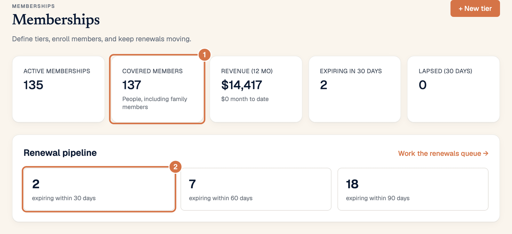

Memberships is where you set up what supporters can join, enroll them, and keep renewals moving. It's an optional module—if **Memberships** isn't in your sidebar, it isn't switched on for your organization.

<Note>
  Memberships used to live under Admin Settings. It's now a section of its own in the sidebar. Bookmarks and older links still work; they send you to the new location.
</Note>

## The vocabulary

Three words do a lot of work here, and they don't mean the same thing.

| Term | Meaning |
| --- | --- |
| **Tier** | What you offer—"Individual," "Family," "Gold"—with a price, a term, and a limit on how many people it covers |
| **Membership** | One supporter's enrollment in a tier |
| **Member** | A person covered by a membership. A family membership covers several |

So a household of four on a Family tier is one membership and four members. Reports that count memberships and reports that count members will give you different numbers, and both are right.

A household is meant to hold one live membership at a time. Adding a new one closes the household's earlier membership, except one that still bills through Stripe. See [When a household already has a membership](/memberships/manage-members#when-a-household-already-has-a-membership).

## What each screen does

<CardGroup cols={2}>
  <Card title="Overview" icon="chart-simple">
    Active memberships, people covered, revenue over the last year, what's expiring in the next 30 days, and what lapsed in the last 30.
  </Card>

  <Card title="Members" icon="users">
    Every enrollment, filtered by status or tier. See [Manage memberships](/memberships/manage-members).
  </Card>

  <Card title="Tiers" icon="layer-group">
    What you offer and what it costs. See [Membership tiers](/settings/memberships).
  </Card>

  <Card title="Enrollment forms" icon="file-pen">
    The public pages supporters join through. See [Membership forms](/forms/membership-forms).
  </Card>

  <Card title="Renewals" icon="rotate">
    What's coming due and what's overdue. See [Renewals](/memberships/renewals).
  </Card>
</CardGroup>

## Setting up from scratch

1. Connect a [payment account](/settings/payments) if you'll take money online.
2. Create your [tiers](/settings/memberships)—name, price, term, and how many people each covers.
3. Build an [enrollment form](/forms/membership-forms) and publish it.
4. Set up a **Membership Receipt** and, if you want them, a **Membership Renewal Reminder** in [templates](/email/templates).

A tier on its own doesn't appear anywhere public and doesn't charge anyone. It has to be on a published form before a supporter can join.

## Reading the numbers on the Overview

The renewal pipeline counts memberships whose term ends inside the next 30, 60, or 90 days. Click any of them to open that list in Members. The dashboard's **Renewals ahead** card shows the same counts, and its **Export CSV** downloads the next 90 days.

**Covered members** counts people, not enrollments: someone covered by two active memberships is counted once. The **individual members** figure on the dashboard's **Memberships** card is the same number.

<Frame caption="The Memberships Overview: (1) Covered members counts people, (2) the renewal pipeline; select a count to open that list in Members.">
  
</Frame>

Lifetime memberships never appear there—they have no term end and never renew. Memberships paid by card renew themselves, and complimentary ones have nothing to collect, so the renewals that actually need a person are the offline ones.

## Sign-ups that need a second look

Advocora attaches an online sign-up to a contact by email. When that attachment is uncertain—the email belongs to someone with a different name, or a new household was created for a name you already have—the sign-up also waits in [Membership Match](/data-management/membership-match) so someone can confirm it or move it to the right contact. The supporter's membership and payment aren't held up by the review.

## Memberships that cover several people

A tier can cover a couple or a whole household. Supporters name the other people while they sign up, and you can add or change them afterwards. See [Couple and family memberships](/memberships/couples-and-families).
