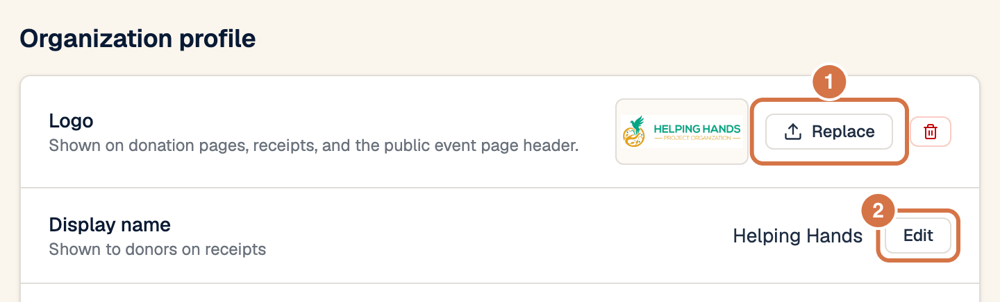
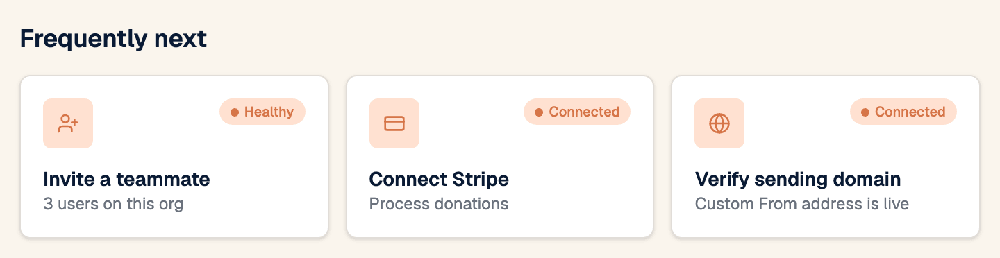

The **General** page (under Settings) holds your organization's core details. They appear on donation pages, receipts, and public event pages, and they set the time zone everything is measured in.

## Editing your details

Each detail sits on its own row with an **Edit** button. Choose **Edit**, change the value, and save. You can set:

| Field | Notes |
| --- | --- |
| **Display name** | Required—how your organization is shown |
| **EIN** | Formats automatically as XX-XXXXXXX |
| **Mailing address** | Street, city, state, ZIP |
| **Phone** | Formats automatically |
| **Website** | Your public site |
| **Billing contact** | Name, email, phone |
| **Timezone** | The basis for dates and "this week" everywhere |

<Frame caption="Each row has its own controls: (1) Replace the logo, or remove it with the button beside it, (2) Edit a detail.">
  
</Frame>

## Your logo

Upload a logo (PNG, JPEG, WebP, or SVG, up to 2 MB) in the logo row—drag-and-drop works too. **Replace** or **Remove** it anytime. It shows on donation pages, receipts, and your public event page header.

<Warning>
  Your **time zone** drives reporting windows, scheduled sends, and dashboard metrics. Set it correctly before you rely on the numbers.
</Warning>

<Tip>
  The **Frequently next** cards on this page tell you, at a glance, whether Stripe is connected and whether a sending domain is verified—handy during setup.
</Tip>

<Frame caption="The Frequently next cards, each with its status at the top right.">
  
</Frame>

## Confirm a change

Save the edited row, reload the page, and inspect the value. Check a relevant form or receipt preview after changing branding or contact information. Review scheduled items individually after a timezone change rather than assuming existing schedules have moved.

If an edit is unavailable, check your role. If a logo upload fails, check the displayed file type and size requirements before trying a different file.
