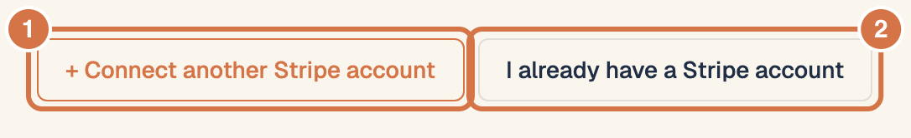
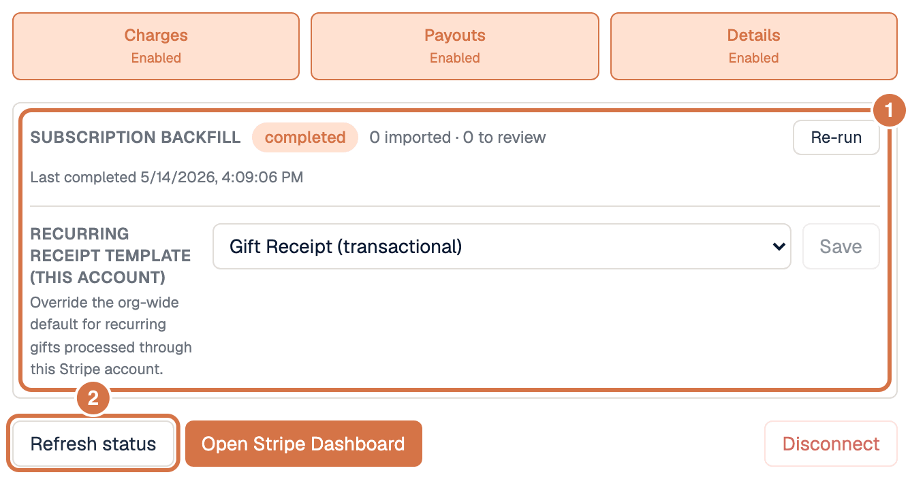

To accept money—through [donation forms](/forms/donation-forms), [events](/events/overview), or [memberships](/settings/memberships)—your organization connects a **Stripe Connect account** on the **Payments** page.

## Connecting an account

<CardGroup cols={2}>
  <Card title="Express (recommended)" icon="bolt">
    Advocora creates a Stripe account for you and walks you through a short onboarding.
  </Card>

  <Card title="Standard" icon="link">
    Already have Stripe? Connect your existing account.
  </Card>
</CardGroup>

When connecting, you'll name the account and pick an account type—501(c)(3), 501(c)(4), PAC, or Other.

<Frame caption="With an account already connected: (1) add another account that Advocora creates for you (Express), (2) connect a Stripe account you already have (Standard).">
  
</Frame>

## Knowing an account is ready

Each account card shows its status. An account is **Ready** only when **charges**, **payouts**, and **details** are all enabled. Until then it shows **Setup pending**—choose **Resume onboarding** to finish. Use **Refresh status** to re-check, and **Set as default** to make one account the default for new forms.

<Warning>
  Forms and paid events can't take money against an account that isn't fully onboarded. If something says "Not ready," finish Stripe onboarding here first.
</Warning>

## Recurring receipts & backfill

Set an organization-wide **default recurring receipt template** (and per-account overrides) so recurring gifts are always receipted. Each account also has a **subscription backfill** panel to import existing Stripe subscriptions—anything that can't be matched automatically waits in [Gifts match](/data-management/gifts-match).

<Frame caption="An account card: the Charges, Payouts, and Details status at the top, (1) its subscription backfill and recurring receipt template, (2) Refresh status.">
  
</Frame>

<Tip>
  Configure a recurring receipt template before you turn on recurring giving, so your sustainers get a receipt from their very first charge.
</Tip>

## Verify the correct account

If your organization has more than one payment account, confirm the account label on each donation form, membership form, and paid event. Setting a default for new work does not mean every existing form has switched accounts.

A successful connection is different from a successful charge. Review the individual transaction before telling a donor payment completed. For missing gift records, investigate reconciliation before recording another payment.
