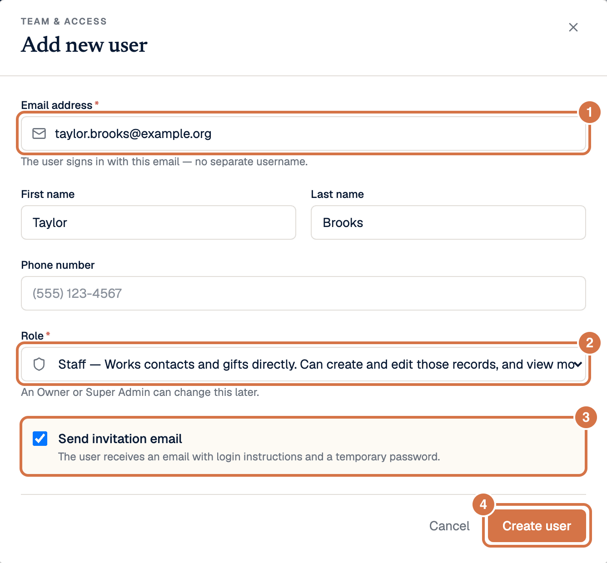
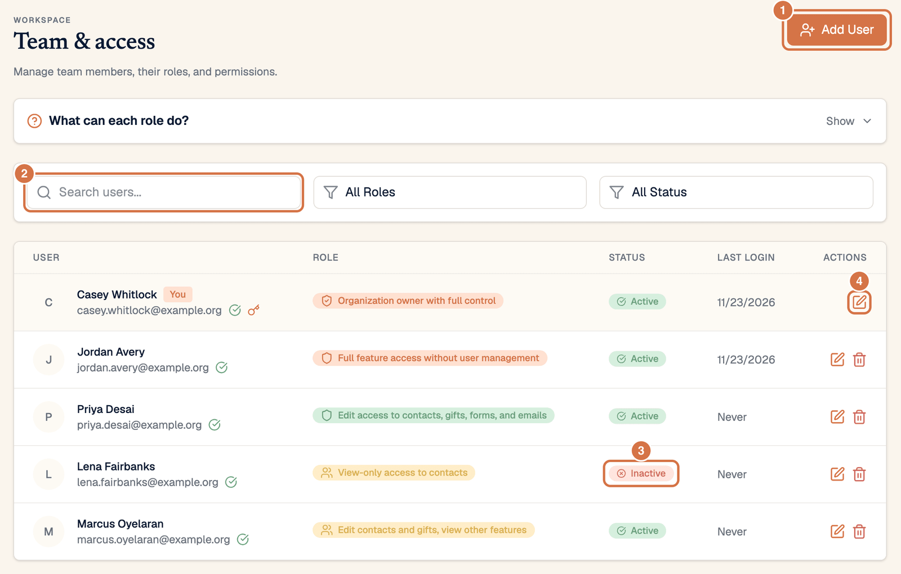
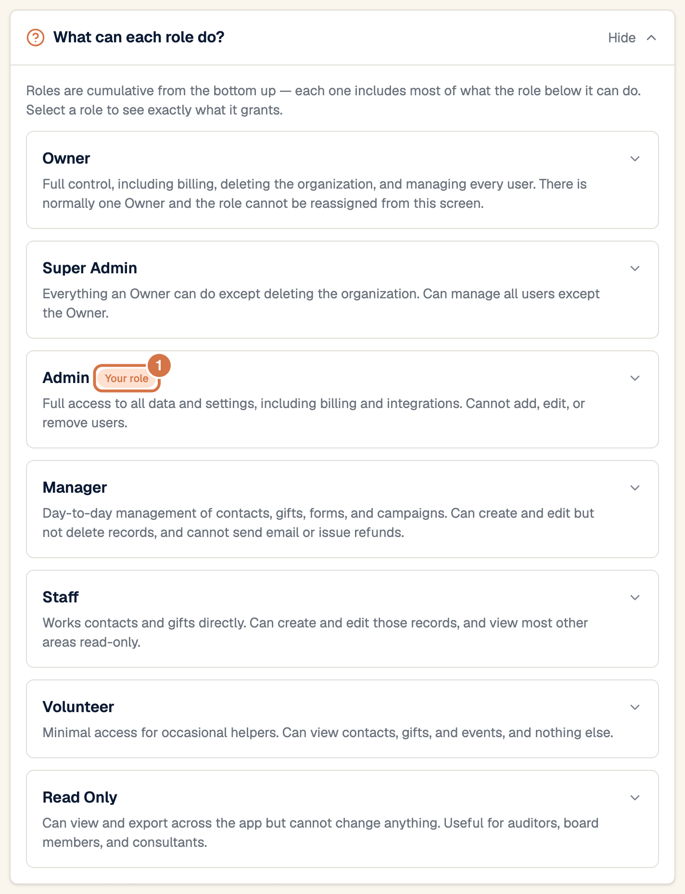

Open **Admin Settings → Team & access**. Under the standard role rules, the **Owner** and **Super Admin** manage users. An **Admin** manages data and settings but cannot manage the team.

An Owner or Super Admin must set up an authenticator app before they can open Settings. Advocora asks for this the first time and then continues to the page.

## Add a teammate

1. Select **Add User** on **Team & access**.
2. Enter the user's email address, name, and optional phone number.
3. Choose the **Role** that matches the person's responsibilities.
4. Choose whether to send an invitation email and submit the form.
5. If you did not send an invitation, copy the temporary password shown once and provide it securely to the teammate. They will need to complete the sign-in setup.
6. Confirm the user appears in the team list. Use search and status indicators to review their account. The **Role** column shows a short description of the role rather than its name.

<Frame caption="Adding a user: (1) the email address they sign in with, (2) Role, (3) the invitation email choice, (4) Create user.">
  
</Frame>

<Frame caption="The team list on Team & access: (1) Add User, (2) search, (3) a user's status, (4) the edit action.">
  
</Frame>

## Choose a role

| Role | Typical access |
| --- | --- |
| Owner | Full control; protected owner account |
| Super Admin | Broad administration and user management, except managing the Owner |
| Admin | Data, settings, integrations, campaign sending, and billing; no user management |
| Manager | Create/edit contacts, gifts, forms, and campaigns; cannot send campaigns; event submissions have their own permission rules |
| Staff | Create/edit contacts and gifts, create/edit events, and view many other areas |
| Volunteer | View contacts, gifts, and events; limited access elsewhere |
| Read Only | View and export permitted data; cannot edit records |

Use the role glossary on **Team & access** for the detailed resource/action matrix. An event's volunteer scanner link is a separate event assignment; it does not create a full CRM user.

<Frame caption="The role glossary on Team & access. Select a role to see what it grants; (1) marks your own role.">
  
</Frame>

## Change or remove access

Open a user's edit action, review their role and account status, and save. An Owner or Super Admin can choose a different **Role** there. The new role applies as soon as you save, and the user does not need to sign in again. You cannot change your own role. Before deleting a user, review the confirmation and ensure they no longer need access.

You cannot delete your own account through team management. The Owner is protected, and a Super Admin cannot manage the Owner. The Owner role cannot be reassigned from this screen.

## Troubleshooting

- **No user-management actions:** confirm you are signed in as Owner or Super Admin.
- **Invitation missing:** confirm the email spelling and invitation choice, then check spam. Choose **Support** in your avatar menu if account setup cannot be completed.
- **Visible page but action denied:** view and change permissions are separate. Check the role glossary for the specific action.
- **A module is missing:** confirm the organization has that module enabled as well as the user's permission.

For personal password and authentication settings, see [Your account](/getting-started/your-account).
